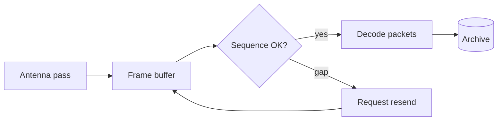

# Telemetry Pipeline

Frames arrive in bursts during each pass, so the ground station buffers them, checks sequence numbers and only then hands them to the decoder.

## Flow



## Decoder

```swift
struct Frame {
    let sequence: UInt32
    let payload: Data
}

func decode(_ frames: [Frame]) throws -> [Packet] {
    try frames.sorted { $0.sequence < $1.sequence }.map(Packet.init)
}
```

## Output

| Field | Type | Notes |
|-------|------|-------|
| sequence | UInt32 | Gaps trigger a resend |
| payload | Data | Up to 1 KiB |
| received | Date | Ground station clock |

## Open questions

- How long do we keep frames after a pass ends?
- Who owns the resend policy?
