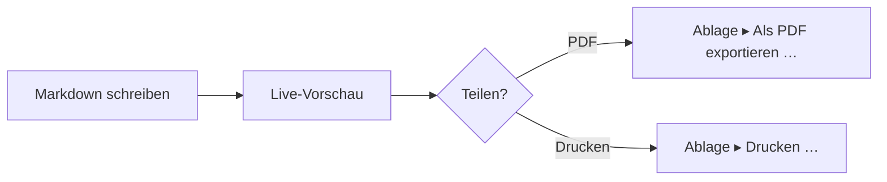

# Mermaid-Vorschau auf dem Mac.

Mit Mermaid schreibst du ein Diagramm als Text in eine Markdown-Datei. Die meisten Editoren zeigen dir den Text. MarsDawn zeichnet das Diagramm: in der Vorschau neben dem Quelltext, in der Übersicht im Finder und im PDF, das du exportierst.

## Das Diagramm als Text schreiben

Lege das Diagramm in einen Codeblock, der mit `mermaid` markiert ist:

````

````

In MarsDawn wird dieser Block zu einem Flussdiagramm: Markdown schreiben, dann Live-Vorschau, dann die Frage „Teilen?“, die zu PDF oder Drucken führt.


## Wo das Diagramm gezeichnet wird

- **In der Vorschau.** Öffne die Datei, und das Diagramm steht neben seinem Quelltext (⌘2). Die Seite aktualisiert sich beim Tippen, und beide Bereiche scrollen gemeinsam.
- **In der Übersicht.** Wähle die Datei im Finder aus und drücke die Leertaste; auch dort werden Diagramme gezeichnet.
- **Im PDF.** „Ablage ▸ Als PDF exportieren …“ und „Ablage ▸ Drucken …“ zeichnen das Diagramm in die Seite. Seitenumbrüche vermeiden es, ein Diagramm in der Mitte zu teilen. Das PDF verwendet die hellen Farben des Themes.
- **Von der Befehlszeile.** Das kostenlose Werkzeug `marsdawn export` zeichnet dieselben Diagramme in ein PDF und braucht die App nicht. Siehe [Befehlszeile](/de/cli/).
- **In deinem Theme.** Die Einstellung „Erscheinungsbild“ der Vorschau gilt auch für Diagramme, ein Diagramm folgt also hell oder dunkel.

## Wenn das Diagramm einen Fehler hat

Wenn Mermaid ein Diagramm nicht zeichnen kann, zeigt die Vorschau den Quelltext des Diagramms mit der vollständigen Fehlermeldung darunter. Nennt die Fehlermeldung eine Zeile, springt der Editor beim Klick auf die Meldung zu dieser Zeile. `marsdawn export --json` meldet fehlgeschlagene Diagramme in `diagramErrors`, sodass ein Skript oder ein Agent erkennt, dass ein Diagramm nicht gezeichnet wurde.

## Was du wissen solltest

- Du bearbeitest den Mermaid-Text. Es gibt keinen visuellen Diagrammeditor, und du kannst in der Vorschau keine Kästchen ziehen.
- Welche Diagrammtypen gezeichnet werden, hängt von der Mermaid-Version in der App ab. MarsDawn 1.1.0 enthält Mermaid 12.0.0. Die Export-Tests des Kits rendern Dokumente unter anderem für Flussdiagramme, Sequenz-, Klassen-, Zustands- und Entity-Relationship-Diagramme, Gantt-Diagramme, Kreisdiagramme, Mindmaps, User Journeys, Zeitleisten und Git-Graphen.
- MarsDawn hat kein KI-Modell und schreibt dir daher kein Diagramm. Die [Flussdiagramm-Vorlage](/de/templates/flowchart/) enthält einen Prompt, den du deinem eigenen Agenten geben kannst.

## Weiter

- Beginne mit einem Diagramm, das schon funktioniert: die [Flussdiagramm-Vorlage](/de/templates/flowchart/).
- Exportiere es: [PDF-Export](/de/pdf/), oder aus einem Skript, [Befehlszeile](/de/cli/).
- Unsicher, wie du die Datei öffnest? [So öffnest du .md-Dateien auf dem Mac](/de/view-markdown-on-mac/).

## Probiere es auf deinem Mac aus

MarsDawn ist kostenlos erhältlich. Teste alles 14 Tage lang und schalte es dann einmalig für 4,99 USD frei. Kein Abo, kein Konto. Es braucht macOS 26 oder neuer.

[Jetzt laden und testen](https://apps.apple.com/app/id6812925073)

## Mehr

- [MarsDawn](https://marsdawn.southern-light.dev/de/index.md): Markdown für Menschen, die agentische Arbeit steuern: ein nativer Mac-Editor mit Live-Vorschau, Mermaid-Diagrammen und PDF-Export. Im Mac App Store.
- [Funktionen](https://marsdawn.southern-light.dev/de/features/index.md): Nativer Markdown-Editor für den Mac: Live-Vorschau, Mermaid, Formeln, Themes und saubere PDF- und Druckseiten für Besprechungen, Randnotizen und Papierakten.
- [Deine Texte bleiben auf deinem Mac](https://marsdawn.southern-light.dev/de/yours/index.md): MarsDawn hat kein Konto, keine Synchronisierung und keine Cloud. Deine Markdown-Dokumente bleiben auf deinem Mac, in den Dateien und Ordnern, die du wählst.
- [Kostenlos testen, einmal bezahlen](https://marsdawn.southern-light.dev/de/pay-once/index.md): MarsDawn ist kostenlos zum Herunterladen. Teste alles 14 Tage lang und schalte es dann einmalig für 4,99 USD frei. Kein Abo, kein Konto.
- [PDF-Export](https://marsdawn.southern-light.dev/de/pdf/index.md): Exportiere Markdown auf deinem Mac als PDF oder drucke es, mit Mermaid-Diagrammen und hervorgehobenem Code. Seitenumbrüche vermeiden es, kurze Codeblöcke zu teilen.
- [Eine Mac-App](https://marsdawn.southern-light.dev/de/native/index.md): Ein Markdown-Editor, der eine echte Mac-App ist: native Fenster und Tabs, automatisches Sichern, Versionsverlauf, Übersicht im Finder und ein Texteditor, der sich wie ein Mac verhält.
- [Was MarsDawn nicht kann](https://marsdawn.southern-light.dev/de/limits/index.md): Keine Synchronisierung, keine iPhone- oder iPad-App, keine Plug-ins, keine Konten. Vier integrierte Themen, mehr in der Galerie. Gut zu wissen, bevor du kaufst.
- [Support](https://marsdawn.southern-light.dev/de/support/index.md): Hilfe zu MarsDawn, dem Markdown-Editor für macOS.
- [Datenschutzrichtlinie](https://marsdawn.southern-light.dev/de/privacy/index.md): MarsDawn erhebt keine personenbezogenen Daten. Deine Dokumente und Einstellungen bleiben auf deinem Mac.
- [So öffnest du .md-Dateien auf dem Mac](https://marsdawn.southern-light.dev/de/view-markdown-on-mac/index.md): So öffnest du eine .md-Datei auf dem Mac: Doppelklick, Standard-App, Übersicht im Finder. Von einem KI-Agenten geschriebene .md liest du gerendert in MarsDawn.
- [Quick Look für Markdown](https://marsdawn.southern-light.dev/de/quicklook/index.md): Mit MarsDawn zeigt die Übersicht Markdown im Finder per Leertaste gerendert: Mermaid, KaTeX, hervorgehobener Code. Sie funktioniert auch nach dem Test weiter.
- [Markdown zu PDF](https://marsdawn.southern-light.dev/de/markdown-to-pdf/index.md): Wandle Markdown auf dem Mac mit dem kostenlosen Befehlszeilenwerkzeug marsdawn in ein PDF um. Mit Homebrew installieren, einen Befehl ausführen: Tabellen, Mathematik, Mermaid und Code.
- [MacMD Viewer vs. MarsDawn](https://marsdawn.southern-light.dev/de/vs/macmd-viewer/index.md): MacMD Viewer ist ein Markdown-Viewer nur zum Lesen für 19,99 USD. MarsDawn bearbeitet und zeigt die Vorschau daneben: 14 Tage kostenlos, dann einmalig 4,99 USD.
- [Befehlszeile](https://marsdawn.southern-light.dev/de/cli/index.md): Das kostenlose Befehlszeilenprogramm marsdawn für den Mac: Markdown aus einer Shell, einem Skript oder einem LLM-Agenten als PDF exportieren, mit JSON-Ausgabe. Installation mit Homebrew.
- [marsdawn für Agenten](https://marsdawn.southern-light.dev/de/cli/agents/index.md): Eine Referenz für KI-Agenten und Skripte, die marsdawn aufrufen, um Markdown in PDF umzuwandeln: Befehle, JSON-Ausgabe, Schemas, Exit-Codes und Voraussetzungen.
- [Agent-Skill](https://marsdawn.southern-light.dev/de/cli/skill/index.md): Eine Datei, die dein Coding-Agent lädt, um geschriebenes Markdown zur Prüfung in MarsDawn zu öffnen, marsdawn zu installieren, Markdown als PDF zu exportieren und das JSON-Ergebnis zu lesen.
- [MCP-Server](https://marsdawn.southern-light.dev/de/cli/mcp/index.md): marsdawn hat kein eigenes KI-Modell, daher ist egal, welcher Agent das Markdown geschrieben hat. Ruf es über die CLI, eine Skill-Datei oder den MCP-Server marsdawn-mcp auf: Alle drei führen denselben Export aus.
- [Review mit wenigen Tokens](https://marsdawn.southern-light.dev/de/token-efficient-review/index.md): Ein Mensch prüft die gerenderte Seite in MarsDawn, sie wird nie in den Kontext des Agenten zurückgelesen. Der Werkzeugaufruf selbst liefert ein kompaktes JSON-Ergebnis statt des gerenderten Inhalts, auch der Aufruf ist also günstig.
- [Markdown anderswo ansehen vs. MarsDawn](https://marsdawn.southern-light.dev/de/vs/markdown-preview-tools/index.md): Wie sich MarsDawn mit dem Lesen von Markdown in der eingebauten Vorschau von VS Code, einer Browsererweiterung oder der Dateivorschau von Claude Desktop vergleicht: was jeweils gerendert wird und was es braucht, eine Datei zu öffnen.
- [Vorschau-Themen und PDF-Export](https://marsdawn.southern-light.dev/de/themes/index.md): Vier Vorschauthemen mit je einer hellen und einer dunklen Palette und ein PDF- und Druckexport, der zum gewählten Thema passt. Bau dein eigenes Thema im Browser und sieh dir die Community-Galerie an.
- [Ein Thema erstellen](https://marsdawn.southern-light.dev/de/themes/new/index.md): Wähle Farben und ein paar Stiloptionen, sieh sie live auf einem Beispieldokument und reiche dein Thema als GitHub-Issue ein. Keine Installation, kein git.
- [Mit deinem Agenten ein Thema erstellen](https://marsdawn.southern-light.dev/de/themes/agents/index.md): MarsDawn-Themen-Referenz für KI-Agenten: jedes Feld der theme.json mit Typ und Bereich, Prüfen und Rendern per CLI, ein Übergabe-Link und die Einreichung.
- [Themen-Galerie](https://marsdawn.southern-light.dev/de/themes/gallery/index.md): Durchsuche Vorschau-Themen, die die Community für MarsDawn eingereicht hat, filtere nach Szenario und melde ein Problem. Bau dein eigenes im Browser, ohne Installation und ohne git.
- [Exportierte PDFs teilen](https://marsdawn.southern-light.dev/de/sharing-exported-pdfs/index.md): Exportiere das Markdown eines Agenten als PDF und gib es einer Kollegin, die kein Markdown liest und nichts installieren wird. Zum Öffnen braucht es keine Syntax, keine App und keinen Account.
- [Warum KI-Ergebnisse weiterhin einen menschlichen Leser brauchen](https://marsdawn.southern-light.dev/de/reviewing-ai-output/index.md): Von KI geschriebenes Markdown muss ein Mensch verstehen, nicht auf den ersten Blick glauben. MarsDawn stellt die gerenderte Seite neben den Quelltext und zeichnet Mermaid-Diagramme und KaTeX-Formeln, damit die Struktur auf einen Blick lesbar ist.
- [Lesen, was dein Agent zurückgibt](https://marsdawn.southern-light.dev/de/reading-agent-output/index.md): KI-Agenten geben ihre Arbeit als Markdown zurück: Pläne, Spezifikationen, Fortschrittsberichte. Was Leute, die Agenten bauen, über Checkpoints und Fehler sagen, warum diese Ausgabe schwer zu lesen ist, und eine Checkliste, um einen Plan in fünf Minuten zu prüfen.
- [Transparenz von Agenten](https://marsdawn.southern-light.dev/de/agent-transparency/index.md): Anthropics Leitfaden zum Bau von Agenten verlangt Transparenz: Zeig die Planungsschritte. Was er sagt, was nicht, und warum die Schritte meist als Markdown-Datei enden, die jemand lesen muss.
- [Den Plan eines Agenten prüfen](https://marsdawn.southern-light.dev/de/reviewing-agent-plans/index.md): Ein Weg in sechs Schritten, den Plan eines KI-Agenten zu prüfen, bevor er läuft, in etwa fünf Minuten und in jedem Editor, mit einem durchgespielten Beispiel.
- [Entwurfsmuster für Agenten](https://marsdawn.southern-light.dev/de/agent-design-patterns/index.md): Reflexion, Werkzeugnutzung, Planung und Zusammenarbeit mehrerer Agenten, wie Andrew Ng sie beschrieben hat, und was jedes Muster dir typischerweise zum Lesen zurückgibt.
- [Änderungsprotokoll](https://marsdawn.southern-light.dev/de/changelog/index.md): Was sich im kostenlosen Befehlszeilenprogramm marsdawn geändert hat.
- [Lektürenotizen der Redaktion](https://marsdawn.southern-light.dev/de/reading-notes/index.md): Sechs kurze Notizen dazu, was die Leute, die KI-Agenten bauen, tatsächlich argumentieren — Anthropic, Chip Huyen, Lilian Weng, Harrison Chase, LangChain und Andrew Ng — und was das jeweils für die Person bedeutet, die lesen muss, was so ein Agent zurückgibt.
- [Lektürenotizen: Anthropic](https://marsdawn.southern-light.dev/de/reading-notes/anthropic-building-effective-agents/index.md): Anthropics Leitfaden vom Dezember 2024 für Leute, die Agenten bauen, trennt Workflows von Agenten und beschreibt fünf Workflow-Muster, darunter eines, bei dem ein zweiter LLM-Aufruf den ersten prüft. Was das für Dateien in deinem Ordner bedeutet.
- [Lektürenotizen: Chip Huyen](https://marsdawn.southern-light.dev/de/reading-notes/chip-huyen-agents/index.md): Chip Huyens Essay „Agents“ vom Januar 2025 teilt Aktionen von Agenten in read-only und write. Warum diese Aufteilung ein schneller Weg ist, in einem Plan die Zeile zu finden, die vor der Freigabe einen genaueren Blick verdient.
- [Lektürenotizen: Lilian Weng](https://marsdawn.southern-light.dev/de/reading-notes/lilian-weng-llm-agents/index.md): Lilian Wengs viel zitierte Umfrage von 2023 beschreibt einen LLM-Agenten als Gehirn plus Planung, Gedächtnis und Werkzeugnutzung. Was jeder Teil dir typischerweise zum Lesen hinterlässt, und die Grenze, die sie bei Plänen nennt, die sich Überraschungen nicht anpassen.
- [Lektürenotizen: Harrison Chase](https://marsdawn.southern-light.dev/de/reading-notes/harrison-chase-what-is-an-agent/index.md): Harrison Chases Definition eines Agenten von 2024 und sein Spektrum agentischen Verhaltens, und sein Plädoyer für Beobachtbarkeit, je weiter ein System darauf wandert — gelesen von der Seite der Person, die die Datei liest, die er zurückgibt.
- [Lektürenotizen: LangChain (Jess Ou)](https://marsdawn.southern-light.dev/de/reading-notes/langchain-what-is-an-agent/index.md): LangChains „What is an AI agent?“ von Jess Ou (2026) greift Harrison Chases Definition von 2024 auf und beschreibt eine Pipeline zur automatischen Bewertung von Agenten. Wo diese Pipeline noch einen Schritt an eine Person übergibt — und wo nicht.
- [Lektürenotizen: Andrew Ng](https://marsdawn.southern-light.dev/de/reading-notes/andrew-ng-design-patterns/index.md): Über fünf Briefe in The Batch ordnet Andrew Ng Reflexion, Werkzeugnutzung, Planung und Multi-Agenten-Zusammenarbeit danach, wie verlässlich und vorhersagbar er jedes findet — und was diese Rangfolge dazu nahelegt, wie genau man die Ausgabe jedes Musters prüfen sollte.
- [Vorlagen](https://marsdawn.southern-light.dev/de/templates/index.md): Markdown-Vorlagen für die Dokumente, die ein Agent schreibt und du liest: eine Spezifikation, ein Flussdiagramm und ein Protokoll, jeweils mit einem Prompt für deinen Agenten.
- [Spezifikationsvorlage](https://marsdawn.southern-light.dev/de/templates/spec/index.md): Eine Markdown-Vorlage für Spezifikationen mit Anforderungen, einem Mermaid-Ablaufdiagramm und Akzeptanzkriterien. Dein Agent füllt sie aus, du prüfst sie in MarsDawn.
- [Flussdiagramm-Vorlage](https://marsdawn.southern-light.dev/de/templates/flowchart/index.md): Eine Mermaid-Flussdiagramm-Vorlage in Markdown, darunter die Schritte ausgeschrieben. Auf dem Mac in der Vorschau ansehen und als PDF exportieren.
- [Protokollvorlage](https://marsdawn.southern-light.dev/de/templates/meeting-notes/index.md): Eine Markdown-Vorlage für Besprechungsprotokolle mit Entscheidungen und Aufgaben, jeweils mit einer verantwortlichen Person. Dein Agent schreibt es, du prüfst es in MarsDawn.
- [English](https://marsdawn.southern-light.dev/mermaid-preview-mac/index.md): See Mermaid diagrams drawn next to your Markdown on a Mac: live preview, Quick Look and PDF export. A broken diagram shows its error and the line.
- [繁體中文](https://marsdawn.southern-light.dev/zh-hant/mermaid-preview-mac/index.md): 在 Mac 上預覽 Mermaid 圖表：原始碼旁邊即時畫出來，快速查看和輸出 PDF 也看得到。圖表寫錯時，會顯示錯誤訊息和出錯的那一行。
- [简体中文](https://marsdawn.southern-light.dev/zh-hans/mermaid-preview-mac/index.md): 在 Mac 上预览 Mermaid 图表：源代码旁边实时画出来，快速查看和导出 PDF 也看得到。图表写错时，会显示错误信息和出错的那一行。
- [日本語](https://marsdawn.southern-light.dev/ja/mermaid-preview-mac/index.md): Mac で Mermaid の図を Markdown の隣に描画：リアルタイムプレビュー、クイックルック、PDF 書き出し。図に誤りがあると、エラーとその行が表示されます。
- [Français](https://marsdawn.southern-light.dev/fr/mermaid-preview-mac/index.md): Diagrammes Mermaid dessinés à côté de votre Markdown sur Mac : aperçu en direct, Coup d’œil et export PDF. Un diagramme erroné affiche l’erreur et la ligne.
- [Español](https://marsdawn.southern-light.dev/es/mermaid-preview-mac/index.md): Diagramas Mermaid junto a tu Markdown en una Mac: vista previa en vivo, Vista rápida y exportación a PDF. Un diagrama con errores muestra el error y la línea.
- [한국어](https://marsdawn.southern-light.dev/ko/mermaid-preview-mac/index.md): Mac에서 Mermaid 다이어그램을 Markdown 옆에 그려서 보세요: 실시간 미리보기, 훑어보기, PDF 내보내기. 다이어그램에 오류가 있으면 오류와 해당 줄이 표시됩니다.
