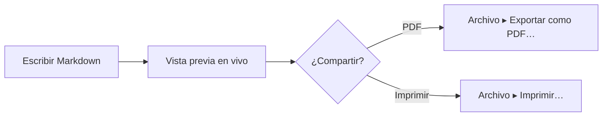

# Vista previa de Mermaid en Mac.

Mermaid te permite escribir un diagrama como texto dentro de un archivo Markdown. La mayoría de los editores te muestran el texto. MarsDawn dibuja el diagrama: en la vista previa junto al código fuente, en Vista rápida en el Finder y en el PDF que exportas.

## Escribe el diagrama como texto

Pon el diagrama en un bloque de código marcado como `mermaid`:

````

````

En MarsDawn, ese bloque se convierte en un diagrama de flujo: Escribir Markdown, luego Vista previa en vivo, luego una elección ¿Compartir? que lleva a PDF o a Imprimir.


## Dónde se dibuja el diagrama

- **En la vista previa.** Abre el archivo y el diagrama aparece junto a su código fuente (⌘2). La página se actualiza mientras escribes, y los dos paneles se desplazan juntos.
- **En Vista rápida.** Selecciona el archivo en el Finder y pulsa la barra espaciadora; allí también se dibujan los diagramas.
- **En el PDF.** «Archivo ▸ Exportar como PDF…» y «Archivo ▸ Imprimir…» dibujan el diagrama en la página. Los saltos de página evitan partir un diagrama por la mitad. El PDF usa los colores claros del tema.
- **Desde la línea de comandos.** La herramienta gratuita `marsdawn export` dibuja los mismos diagramas en un PDF y no necesita la app. Consulta [Línea de comandos](/es/cli/).
- **En tu tema.** El ajuste Aspecto de la vista previa también se aplica a los diagramas, así que un diagrama sigue el modo claro u oscuro.

## Cuando el diagrama tiene un error

Si Mermaid no puede dibujar un diagrama, la vista previa muestra el código del diagrama con el mensaje de error completo debajo. Cuando el error indica una línea, haz clic en el mensaje y el editor salta a esa línea. `marsdawn export --json` informa de los diagramas fallidos en `diagramErrors`, de modo que un script o un agente sepa que un diagrama no se dibujó.

## Qué conviene saber

- Tú editas el texto de Mermaid. No hay un editor visual de diagramas, y no puedes arrastrar cajas en la vista previa.
- Qué tipos de diagrama se dibujan depende de la versión de Mermaid que lleva la app. MarsDawn 1.1.0 incluye Mermaid 12.0.0. Las pruebas de exportación del kit renderizan documentos para diagramas de flujo, de secuencia, de clases, de estados, entidad-relación, de Gantt, gráficos circulares, mapas mentales, recorridos de usuario, líneas de tiempo y gráficos de git, entre otros.
- MarsDawn no tiene un modelo de IA, así que no te escribe un diagrama. La [plantilla de diagrama de flujo](/es/templates/flowchart/) tiene un prompt que puedes darle a tu propio agente.

## Siguiente

- Empieza con un diagrama que ya funciona: la [plantilla de diagrama de flujo](/es/templates/flowchart/).
- Expórtalo: [Exportación a PDF](/es/pdf/), o desde un script, [Línea de comandos](/es/cli/).
- ¿No sabes cómo abrir el archivo? [Cómo abrir archivos .md en Mac](/es/view-markdown-on-mac/).

## Pruébalo en tu Mac

MarsDawn se descarga gratis. Prueba todo durante 14 días y desbloquéalo una sola vez por 4,99 USD. Sin suscripción y sin cuenta. Requiere macOS 26 o posterior.

[Descárgala y pruébala](https://apps.apple.com/app/id6812925073)

## Más

- [MarsDawn](https://marsdawn.southern-light.dev/es/index.md): Lee y revisa el Markdown de tu agente en tu Mac: vista previa dividida en vivo, Mermaid, KaTeX, Vista rápida y PDF. Pruébalo gratis y luego 4,99 USD una vez.
- [Funciones](https://marsdawn.southern-light.dev/es/features/index.md): Editor de Markdown nativo para Mac: vista previa, Mermaid, fórmulas, temas y páginas en PDF o impresas para reuniones, notas al margen y registros en papel.
- [Lo que escribes se queda en tu Mac](https://marsdawn.southern-light.dev/es/yours/index.md): MarsDawn no tiene cuenta, ni sincronización, ni nube. Tus documentos Markdown se quedan en tu Mac, en los archivos y carpetas que elijas.
- [Pruébalo gratis, paga una vez](https://marsdawn.southern-light.dev/es/pay-once/index.md): MarsDawn se descarga gratis. Prueba todo durante 14 días y desbloquéalo una sola vez por 4,99 USD. Sin suscripción y sin cuenta.
- [Exportación a PDF](https://marsdawn.southern-light.dev/es/pdf/index.md): Exporta Markdown como PDF o imprímelo en tu Mac, con diagramas Mermaid y código resaltado. Los saltos de página evitan partir bloques de código cortos.
- [Una app para Mac](https://marsdawn.southern-light.dev/es/native/index.md): Un editor de Markdown que es una app de Mac de verdad: ventanas y pestañas nativas, guardado automático, historial de versiones, Vista rápida en el Finder y un editor de texto que se comporta como en la Mac.
- [Lo que MarsDawn no hace](https://marsdawn.southern-light.dev/es/limits/index.md): Sin sincronización, sin app para iPhone o iPad, sin plugins, sin cuentas. Cuatro temas integrados y más en la galería. Lo que conviene saber antes de comprar.
- [Soporte](https://marsdawn.southern-light.dev/es/support/index.md): Ayuda con MarsDawn, el editor de Markdown para macOS.
- [Política de privacidad](https://marsdawn.southern-light.dev/es/privacy/index.md): MarsDawn no recopila datos personales. Tus documentos y tus ajustes se quedan en tu Mac.
- [Cómo abrir archivos .md en Mac](https://marsdawn.southern-light.dev/es/view-markdown-on-mac/index.md): Cómo abrir un archivo .md en una Mac: doble clic, app predeterminada, Vista rápida en el Finder. Lee en MarsDawn, ya renderizados, los .md de un agente de IA.
- [Quick Look para Markdown](https://marsdawn.southern-light.dev/es/quicklook/index.md): Con MarsDawn, Vista rápida renderiza Markdown en el Finder con la barra espaciadora: Mermaid, KaTeX y código resaltado. Sigue funcionando tras la prueba.
- [De Markdown a PDF](https://marsdawn.southern-light.dev/es/markdown-to-pdf/index.md): Convierte Markdown a PDF en Mac con la herramienta de línea de comandos gratuita marsdawn. Instálala con Homebrew y ejecuta un solo comando: tablas, matemáticas, Mermaid y código.
- [MacMD Viewer frente a MarsDawn](https://marsdawn.southern-light.dev/es/vs/macmd-viewer/index.md): MacMD Viewer es un visor de Markdown de solo lectura por 19,99 USD. MarsDawn edita con la vista previa al lado: 14 días gratis y luego 4,99 USD una sola vez.
- [Línea de comandos](https://marsdawn.southern-light.dev/es/cli/index.md): La herramienta de línea de comandos gratuita marsdawn para Mac: exporta Markdown a PDF desde una shell, un script o un agente LLM, con salida JSON. Se instala con Homebrew.
- [marsdawn para agentes](https://marsdawn.southern-light.dev/es/cli/agents/index.md): Una referencia para agentes de IA y scripts que llaman a marsdawn para convertir Markdown en PDF: comandos, salida JSON, esquemas, códigos de salida y requisitos.
- [Skill para agentes](https://marsdawn.southern-light.dev/es/cli/skill/index.md): Un archivo que tu agente de programación carga para abrir en MarsDawn el Markdown que escribió, para que lo revises, y para instalar marsdawn, exportar Markdown a PDF y leer el resultado JSON.
- [Servidor MCP](https://marsdawn.southern-light.dev/es/cli/mcp/index.md): marsdawn no tiene un modelo de IA propio, así que no importa qué agente escribió el Markdown. Llámalo desde la CLI, un archivo de skill o el servidor MCP marsdawn-mcp: los tres ejecutan la misma exportación.
- [Revisión que ahorra tokens](https://marsdawn.southern-light.dev/es/token-efficient-review/index.md): Una persona revisa la página renderizada en MarsDawn, y nunca se vuelve a leer en el contexto del agente. La llamada a la herramienta devuelve un resultado JSON compacto, no el contenido renderizado, así que llamarla también sale barato.
- [Ver Markdown en otras herramientas frente a MarsDawn](https://marsdawn.southern-light.dev/es/vs/markdown-preview-tools/index.md): Cómo se compara MarsDawn con leer Markdown en la vista previa integrada de VS Code, una extensión del navegador o la vista previa de archivos de Claude Desktop: qué renderiza cada uno y qué hace falta para abrir un archivo.
- [Temas de la vista previa y exportación a PDF](https://marsdawn.southern-light.dev/es/themes/index.md): Cuatro temas de vista previa, cada uno con una paleta clara y una oscura, y una sola exportación a PDF e impresión que respeta el que estés usando. Crea tu propio tema en el navegador y explora la galería de la comunidad.
- [Crear un tema](https://marsdawn.southern-light.dev/es/themes/new/index.md): Elige colores y unas pocas opciones de estilo, míralos aplicados en vivo a un documento de ejemplo y envía tu tema como un issue de GitHub. Sin instalación, sin git.
- [Crea un tema con tu agente](https://marsdawn.southern-light.dev/es/themes/agents/index.md): Referencia de temas de MarsDawn para agentes de IA: cada campo de theme.json con tipo y rango, comprobación y renderizado por CLI, enlace de entrega y envío.
- [Galería de temas](https://marsdawn.southern-light.dev/es/themes/gallery/index.md): Explora temas de vista previa que la comunidad envió para MarsDawn, fíltralos por escenario y denuncia un problema. Crea el tuyo en el navegador, sin instalación y sin git.
- [Compartir los PDF exportados](https://marsdawn.southern-light.dev/es/sharing-exported-pdfs/index.md): Exporta a PDF el Markdown de un agente y entrégaselo a un colega que no lee Markdown y no va a instalar nada. Para abrirlo no hace falta sintaxis, ni app, ni cuenta.
- [Por qué lo que produce la IA todavía necesita un lector humano](https://marsdawn.southern-light.dev/es/reviewing-ai-output/index.md): El Markdown escrito por una IA tiene que entenderlo una persona, no creerlo a simple vista. MarsDawn pone la página renderizada junto al código fuente y dibuja diagramas Mermaid y fórmulas KaTeX, para que la estructura se lea de un vistazo.
- [Leer lo que te devuelve tu agente](https://marsdawn.southern-light.dev/es/reading-agent-output/index.md): Los agentes de IA entregan su trabajo en Markdown: planes, especificaciones, informes de avance. Qué dicen quienes construyen agentes sobre los puntos de control y los fallos, por qué ese resultado cuesta leerlo y una lista para revisar un plan en cinco minutos.
- [Transparencia de los agentes](https://marsdawn.southern-light.dev/es/agent-transparency/index.md): La guía de Anthropic para construir agentes pide transparencia: mostrar los pasos de planificación. Qué dice, qué no dice y por qué esos pasos suelen terminar en un archivo Markdown que alguien tiene que leer.
- [Revisar el plan de un agente](https://marsdawn.southern-light.dev/es/reviewing-agent-plans/index.md): Un método de seis pasos para revisar el plan que te entrega un agente de IA antes de que se ejecute, en unos cinco minutos y en cualquier editor, con un ejemplo detallado.
- [Patrones de diseño de agentes](https://marsdawn.southern-light.dev/es/agent-design-patterns/index.md): Reflexión, uso de herramientas, planificación y colaboración multiagente, tal como los describió Andrew Ng, y lo que cada uno suele entregarte para leer.
- [Historial de cambios](https://marsdawn.southern-light.dev/es/changelog/index.md): Qué cambió en la herramienta de línea de comandos gratuita marsdawn.
- [Notas de lectura de la redacción](https://marsdawn.southern-light.dev/es/reading-notes/index.md): Seis notas breves sobre lo que argumentan de verdad las personas que construyen agentes de IA — Anthropic, Chip Huyen, Lilian Weng, Harrison Chase, LangChain y Andrew Ng — y qué significa cada una para quien tiene que leer lo que ese agente devuelve.
- [Notas de lectura: Anthropic](https://marsdawn.southern-light.dev/es/reading-notes/anthropic-building-effective-agents/index.md): La guía de Anthropic de diciembre de 2024 para quien construye agentes separa workflows de agentes y describe cinco patrones de workflow, incluido uno en el que una segunda llamada a un LLM revisa la primera. Qué significa eso para lo que aterriza en tu carpeta.
- [Notas de lectura: Chip Huyen](https://marsdawn.southern-light.dev/es/reading-notes/chip-huyen-agents/index.md): El ensayo «Agents» de Chip Huyen de enero de 2025 reparte las acciones de un agente en read-only y write. Por qué esa división es una forma rápida de ver, en un plan, la línea que merece una mirada más atenta antes de aprobar.
- [Notas de lectura: Lilian Weng](https://marsdawn.southern-light.dev/es/reading-notes/lilian-weng-llm-agents/index.md): La encuesta muy citada de Lilian Weng de 2023 describe un agente LLM como un cerebro más planificación, memoria y uso de herramientas. Qué suele dejarte cada parte para leer, y el límite que nombra en planes que no se ajustan a las sorpresas.
- [Notas de lectura: Harrison Chase](https://marsdawn.southern-light.dev/es/reading-notes/harrison-chase-what-is-an-agent/index.md): La definición de agente de Harrison Chase de 2024 y su espectro de comportamiento agentic, y su argumento a favor de la observabilidad a medida que un sistema avanza por él — leído desde quien lee el archivo que te devuelve.
- [Notas de lectura: LangChain (Jess Ou)](https://marsdawn.southern-light.dev/es/reading-notes/langchain-what-is-an-agent/index.md): El «What is an AI agent?» de LangChain de Jess Ou (2026) recoge la definición de 2024 de Harrison Chase y describe un pipeline para evaluar agentes automáticamente. Dónde ese pipeline todavía entrega un paso a una persona — y dónde no.
- [Notas de lectura: Andrew Ng](https://marsdawn.southern-light.dev/es/reading-notes/andrew-ng-design-patterns/index.md): A lo largo de cinco cartas en The Batch, Andrew Ng ordena reflexión, uso de herramientas, planificación y colaboración multiagente según lo fiables y predecibles que le parecen — y qué sugiere ese orden sobre con cuánto cuidado conviene comprobar la salida de cada uno.
- [Plantillas](https://marsdawn.southern-light.dev/es/templates/index.md): Plantillas de Markdown para los documentos que escribe un agente y lees tú: una especificación, un diagrama de flujo y una minuta de reunión, cada una con un prompt para tu agente.
- [Plantilla de especificación](https://marsdawn.southern-light.dev/es/templates/spec/index.md): Una plantilla de especificación en Markdown con requisitos, un diagrama de flujo Mermaid y criterios de aceptación. Tu agente la completa; tú la revisas en MarsDawn.
- [Plantilla de diagrama de flujo](https://marsdawn.southern-light.dev/es/templates/flowchart/index.md): Una plantilla de diagrama de flujo Mermaid en Markdown, con los pasos escritos debajo. Previsualízala en la Mac y expórtala a PDF.
- [Plantilla de minuta de reunión](https://marsdawn.southern-light.dev/es/templates/meeting-notes/index.md): Una plantilla de minuta de reunión en Markdown con decisiones y tareas, cada una con un responsable. Tu agente la redacta; tú la revisas en MarsDawn.
- [English](https://marsdawn.southern-light.dev/mermaid-preview-mac/index.md): See Mermaid diagrams drawn next to your Markdown on a Mac: live preview, Quick Look and PDF export. A broken diagram shows its error and the line.
- [繁體中文](https://marsdawn.southern-light.dev/zh-hant/mermaid-preview-mac/index.md): 在 Mac 上預覽 Mermaid 圖表：原始碼旁邊即時畫出來，快速查看和輸出 PDF 也看得到。圖表寫錯時，會顯示錯誤訊息和出錯的那一行。
- [简体中文](https://marsdawn.southern-light.dev/zh-hans/mermaid-preview-mac/index.md): 在 Mac 上预览 Mermaid 图表：源代码旁边实时画出来，快速查看和导出 PDF 也看得到。图表写错时，会显示错误信息和出错的那一行。
- [日本語](https://marsdawn.southern-light.dev/ja/mermaid-preview-mac/index.md): Mac で Mermaid の図を Markdown の隣に描画：リアルタイムプレビュー、クイックルック、PDF 書き出し。図に誤りがあると、エラーとその行が表示されます。
- [Deutsch](https://marsdawn.southern-light.dev/de/mermaid-preview-mac/index.md): Mermaid-Diagramme auf dem Mac neben deinem Markdown: Live-Vorschau, Übersicht und PDF-Export. Ein fehlerhaftes Diagramm zeigt den Fehler und die Zeile.
- [Français](https://marsdawn.southern-light.dev/fr/mermaid-preview-mac/index.md): Diagrammes Mermaid dessinés à côté de votre Markdown sur Mac : aperçu en direct, Coup d’œil et export PDF. Un diagramme erroné affiche l’erreur et la ligne.
- [한국어](https://marsdawn.southern-light.dev/ko/mermaid-preview-mac/index.md): Mac에서 Mermaid 다이어그램을 Markdown 옆에 그려서 보세요: 실시간 미리보기, 훑어보기, PDF 내보내기. 다이어그램에 오류가 있으면 오류와 해당 줄이 표시됩니다.
