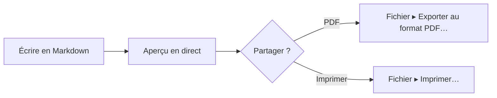

# Aperçu Mermaid sur Mac.

Mermaid permet d’écrire un diagramme sous forme de texte dans un fichier Markdown. La plupart des éditeurs vous montrent le texte. MarsDawn dessine le diagramme : dans l’aperçu à côté de la source, dans Coup d’œil dans le Finder, et dans le PDF que vous exportez.

## Écrire le diagramme sous forme de texte

Placez le diagramme dans un bloc de code marqué `mermaid` :

````

````

Dans MarsDawn, ce bloc devient un organigramme : Écrire en Markdown, puis Aperçu en direct, puis un choix Partager ? qui mène à PDF ou à Imprimer.


## Où le diagramme est dessiné

- **Dans l’aperçu.** Ouvrez le fichier et le diagramme se trouve à côté de sa source (⌘2). La page se met à jour pendant la saisie, et les deux volets défilent ensemble.
- **Dans Coup d’œil.** Sélectionnez le fichier dans le Finder et appuyez sur la barre d’espace ; les diagrammes y sont dessinés aussi.
- **Dans le PDF.** « Fichier ▸ Exporter au format PDF… » et « Fichier ▸ Imprimer… » dessinent le diagramme dans la page. Les sauts de page évitent de couper un diagramme en deux. Le PDF utilise les couleurs claires du thème.
- **En ligne de commande.** L’outil gratuit `marsdawn export` dessine les mêmes diagrammes dans un PDF, sans avoir besoin de l’app. Voir [Ligne de commande](/fr/cli/).
- **Dans votre thème.** Le réglage Apparence de l’aperçu s’applique aussi aux diagrammes, un diagramme suit donc le clair ou le sombre.

## Quand le diagramme contient une erreur

Si Mermaid ne peut pas dessiner un diagramme, l’aperçu affiche la source du diagramme avec le message d’erreur complet en dessous. Quand l’erreur indique une ligne, cliquez sur le message et l’éditeur saute à cette ligne. `marsdawn export --json` signale les diagrammes en échec dans `diagramErrors`, ce qui permet à un script ou à un agent de savoir qu’un diagramme n’a pas été dessiné.

## À savoir

- Vous modifiez le texte Mermaid. Il n’y a pas d’éditeur visuel de diagrammes, et vous ne pouvez pas déplacer de cases dans l’aperçu.
- Les types de diagrammes qui s’affichent dépendent de la version de Mermaid intégrée à l’app. MarsDawn 1.1.0 inclut Mermaid 12.0.0. Les tests d’export du kit rendent des documents pour les organigrammes, les diagrammes de séquence, de classes, d’états, entité-relation, de Gantt, les camemberts, les cartes mentales, les parcours utilisateur, les frises chronologiques et les graphes git, entre autres.
- MarsDawn n’a pas de modèle d’IA, il n’écrit donc pas de diagramme à votre place. Le [modèle d’organigramme](/fr/templates/flowchart/) contient un prompt que vous pouvez donner à votre propre agent.

## Pour aller plus loin

- Partez d’un diagramme qui fonctionne déjà : le [modèle d’organigramme](/fr/templates/flowchart/).
- Exportez-le : [Export PDF](/fr/pdf/), ou depuis un script, [Ligne de commande](/fr/cli/).
- Vous ne savez pas comment ouvrir le fichier ? [Ouvrir un fichier .md sur Mac](/fr/view-markdown-on-mac/).

## Essayez-le sur votre Mac

MarsDawn se télécharge gratuitement. Essayez tout pendant 14 jours, puis déverrouillez-le une fois pour 4,99 USD. Sans abonnement, sans compte. macOS 26 ou version ultérieure est requis.

[Télécharger et essayer](https://apps.apple.com/app/id6812925073)

## Plus

- [MarsDawn](https://marsdawn.southern-light.dev/fr/index.md): Relisez le Markdown, JSON et YAML de votre agent sur Mac : aperçu en direct, Mermaid, KaTeX, Coup d’œil, export PDF. Essai gratuit, puis 4,99 USD une fois.
- [Fonctionnalités](https://marsdawn.southern-light.dev/fr/features/index.md): Éditeur Mac natif pour Markdown, JSON et YAML : aperçu en direct, Mermaid, formules, thèmes et pages PDF ou imprimées pour réunions et dossiers papier.
- [Vos textes restent sur votre Mac](https://marsdawn.southern-light.dev/fr/yours/index.md): MarsDawn n’a ni compte, ni synchronisation, ni cloud. Vos documents Markdown restent sur votre Mac, dans les fichiers et dossiers que vous choisissez.
- [Essai gratuit, achat unique](https://marsdawn.southern-light.dev/fr/pay-once/index.md): MarsDawn se télécharge gratuitement. Essayez tout pendant 14 jours, puis déverrouillez-le une fois pour 4,99 USD. Sans abonnement, sans compte.
- [Export PDF](https://marsdawn.southern-light.dev/fr/pdf/index.md): Exportez du Markdown en PDF ou imprimez-le sur votre Mac, avec les diagrammes Mermaid et le code en couleur. Les sauts de page évitent de couper les blocs de code courts.
- [Une app Mac](https://marsdawn.southern-light.dev/fr/native/index.md): Un éditeur Markdown qui est une vraie app Mac : fenêtres et onglets natifs, enregistrement automatique, historique des versions, Coup d’œil dans le Finder et un éditeur de texte qui se comporte comme sur Mac.
- [Ce que MarsDawn ne fait pas](https://marsdawn.southern-light.dev/fr/limits/index.md): Pas de synchronisation, pas de modification sur iPhone ou iPad, pas de plug-ins, pas de comptes. Des thèmes, mais pas de CSS personnalisé. À savoir avant d’acheter.
- [Assistance](https://marsdawn.southern-light.dev/fr/support/index.md): De l’aide pour MarsDawn, l’éditeur Markdown pour macOS.
- [Politique de confidentialité](https://marsdawn.southern-light.dev/fr/privacy/index.md): MarsDawn ne collecte aucune donnée personnelle. Vos documents et vos réglages restent sur votre Mac.
- [Ouvrir un fichier .md sur Mac](https://marsdawn.southern-light.dev/fr/view-markdown-on-mac/index.md): Ouvrir un fichier .md sur Mac : double-clic, app par défaut, Coup d’œil dans le Finder. Les .md écrits par un agent IA se lisent mis en forme dans MarsDawn.
- [Coup d’œil pour Markdown](https://marsdawn.southern-light.dev/fr/quicklook/index.md): Avec MarsDawn, Coup d’œil affiche le Markdown mis en forme dans le Finder avec Espace : Mermaid, KaTeX, code coloré. Il fonctionne toujours après l’essai.
- [Markdown vers PDF](https://marsdawn.southern-light.dev/fr/markdown-to-pdf/index.md): Convertissez du Markdown en PDF sur Mac avec l’outil en ligne de commande gratuit marsdawn. Installez-le avec Homebrew et lancez une seule commande : tableaux, maths, Mermaid et code.
- [MarsDawn comparé : aperçu VS Code, Obsidian, QLMarkdown, LynxOffice](https://marsdawn.southern-light.dev/fr/vs/index.md): Pour celles et ceux qui choisissent comment lire et relire du Markdown sur Mac, souvent écrit par un agent. Chaque cellule ci-dessous vient des pages du fournisseur ou de notre propre vérification, toutes au 16 octobre 2026 ; les produits évoluent, une cellule peut donc vieillir. Si vous repérez une erreur, écrivez à l’adresse indiquée sur Assistance.
- [MacMD Viewer vs MarsDawn](https://marsdawn.southern-light.dev/fr/vs/macmd-viewer/index.md): MacMD Viewer est une visionneuse Markdown en lecture seule à 19,99 USD. MarsDawn modifie avec l’aperçu à côté : 14 jours gratuits, puis 4,99 USD une seule fois.
- [Meilleur lecteur Markdown pour Mac (2026)](https://marsdawn.southern-light.dev/fr/best-markdown-viewer-mac/index.md): Huit lecteurs Markdown pour Mac comparés : prix, Mermaid, maths, PDF, rechargement en direct, Coup d’œil, natif ou Electron, et à qui chacun convient.
- [Ligne de commande](https://marsdawn.southern-light.dev/fr/cli/index.md): L’outil en ligne de commande gratuit marsdawn pour Mac : exportez du Markdown en PDF depuis un shell, un script ou un agent LLM, avec une sortie JSON. S’installe avec Homebrew.
- [marsdawn pour les agents](https://marsdawn.southern-light.dev/fr/cli/agents/index.md): Une référence pour les agents IA et les scripts qui appellent marsdawn pour convertir du Markdown en PDF : commandes, sortie JSON, schémas, codes de sortie et configuration requise.
- [Skill pour agents](https://marsdawn.southern-light.dev/fr/cli/skill/index.md): Un fichier que votre agent de code charge pour ouvrir dans MarsDawn le Markdown qu’il a écrit, afin que vous le relisiez, et pour installer marsdawn, exporter du Markdown en PDF et lire le résultat JSON.
- [Serveur MCP](https://marsdawn.southern-light.dev/fr/cli/mcp/index.md): marsdawn n’a pas de modèle d’IA à lui : peu importe quel agent a écrit le Markdown. Appelez-le depuis la CLI, un fichier de compétence ou le serveur MCP marsdawn-mcp : tous trois lancent le même export.
- [Relire en économisant les tokens](https://marsdawn.southern-light.dev/fr/token-efficient-review/index.md): Une personne relit la page rendue dans MarsDawn ; elle n’est jamais relue dans le contexte de l’agent. L’appel d’outil renvoie un résultat JSON compact, pas le contenu rendu : l’appeler coûte donc peu aussi.
- [Afficher du Markdown ailleurs vs MarsDawn](https://marsdawn.southern-light.dev/fr/vs/markdown-preview-tools/index.md): MarsDawn comparé à la lecture du Markdown dans l’aperçu intégré de VS Code, une extension de navigateur ou l’aperçu de fichiers de Claude Desktop : ce que chacun affiche, et ce qu’il faut pour ouvrir un fichier.
- [Thèmes](https://marsdawn.southern-light.dev/fr/themes/index.md): Quatre thèmes d’aperçu intégrés, chacun clair et sombre, et une galerie vérifiée dans les réglages de MarsDawn pour Mac. Coup d’œil utilise votre thème.
- [Créer un thème](https://marsdawn.southern-light.dev/fr/themes/new/index.md): Choisissez des couleurs et quelques options de style, voyez-les appliquées en direct à un document d’exemple, et envoyez votre thème en issue GitHub. Pas d’installation, pas de git.
- [Créer un thème avec votre agent](https://marsdawn.southern-light.dev/fr/themes/agents/index.md): Référence des thèmes MarsDawn pour agents IA : chaque champ de theme.json avec type et plage, vérification et rendu en CLI, lien à transmettre, soumission.
- [Galerie de thèmes](https://marsdawn.southern-light.dev/fr/themes/gallery/index.md): Parcourez les thèmes d’aperçu pour MarsDawn, chacun relu par le développeur, filtrez par scénario et signalez un problème. Créez le vôtre dans le navigateur.
- [Partager les PDF exportés](https://marsdawn.southern-light.dev/fr/sharing-exported-pdfs/index.md): Exportez le Markdown d’un agent en PDF et remettez-le à un collègue qui ne lit pas le Markdown et n’installera rien. Aucune syntaxe, aucune app et aucun compte nécessaires pour l’ouvrir.
- [Pourquoi ce que produit l’IA a encore besoin d’un lecteur humain](https://marsdawn.southern-light.dev/fr/reviewing-ai-output/index.md): Le Markdown écrit par une IA doit être compris par une personne, pas cru sur parole. MarsDawn place la page rendue à côté de la source et dessine les diagrammes Mermaid et les formules KaTeX, pour que la structure se lise d’un coup d’œil.
- [Lire ce que votre agent vous rend](https://marsdawn.southern-light.dev/fr/reading-agent-output/index.md): Les agents IA rendent leur travail en Markdown : plans, spécifications, rapports d’avancement. Ce que disent ceux qui construisent des agents sur les points de contrôle et les échecs, pourquoi ces fichiers sont difficiles à lire, et une liste de vérification pour relire un plan en cinq minutes.
- [Transparence des agents](https://marsdawn.southern-light.dev/fr/agent-transparency/index.md): Le guide d’Anthropic pour construire des agents demande de la transparence : montrer les étapes de planification. Ce qu’il dit, ce qu’il ne dit pas, et pourquoi ces étapes finissent généralement dans un fichier Markdown que quelqu’un doit lire.
- [Relire le plan d’un agent](https://marsdawn.southern-light.dev/fr/reviewing-agent-plans/index.md): Une méthode en six étapes pour relire le plan qu’un agent IA vous remet avant qu’il ne s’exécute, en cinq minutes environ et dans n’importe quel éditeur, avec un exemple détaillé.
- [Patrons de conception d’agents](https://marsdawn.southern-light.dev/fr/agent-design-patterns/index.md): Réflexion, utilisation d’outils, planification et collaboration multi-agents, tels qu’Andrew Ng les a décrits, et ce que chacun vous rend généralement à lire.
- [Historique des versions](https://marsdawn.southern-light.dev/fr/changelog/index.md): Ce qui a changé dans chaque version de l’app MarsDawn et de l’outil en ligne de commande gratuit marsdawn.
- [Feuille de route](https://marsdawn.southern-light.dev/fr/roadmap/index.md): Ce qui est en cours et ce qui vient ensuite pour MarsDawn sur Mac, iPhone et iPad, version par version. Sans dates ; les idées non planifiées sont signalées.
- [Notes de lecture de la rédaction](https://marsdawn.southern-light.dev/fr/reading-notes/index.md): Six courtes notes sur ce que les gens qui construisent des agents IA avancent réellement — Anthropic, Chip Huyen, Lilian Weng, Harrison Chase, LangChain et Andrew Ng — et ce que cela signifie pour la personne qui doit lire ce qu’un tel agent rend.
- [Notes de lecture : Anthropic](https://marsdawn.southern-light.dev/fr/reading-notes/anthropic-building-effective-agents/index.md): Le guide d’Anthropic de décembre 2024 pour qui construit des agents sépare workflows et agents et décrit cinq patrons de workflow, dont un où un second appel LLM relit le premier. Ce que cela signifie pour ce qui atterrit dans votre dossier.
- [Notes de lecture : Chip Huyen](https://marsdawn.southern-light.dev/fr/reading-notes/chip-huyen-agents/index.md): L’essai « Agents » de Chip Huyen de janvier 2025 partage les actions d’un agent en read-only et write. Pourquoi cette distinction est un moyen rapide de repérer, dans un plan, la ligne qui mérite un regard plus attentif avant d’approuver.
- [Notes de lecture : Lilian Weng](https://marsdawn.southern-light.dev/fr/reading-notes/lilian-weng-llm-agents/index.md): L’enquête très citée de Lilian Weng en 2023 décrit un agent LLM comme un cerveau plus planification, mémoire et usage d’outils. Ce que chaque partie tend à vous laisser à lire, et la limite qu’elle nomme dans les plans qui ne s’ajustent pas aux surprises.
- [Notes de lecture : Harrison Chase](https://marsdawn.southern-light.dev/fr/reading-notes/harrison-chase-what-is-an-agent/index.md): La définition d’un agent de Harrison Chase en 2024 et son spectre de comportement agentic, et son plaidoyer pour l’observabilité à mesure qu’un système avance dessus — lu du côté de qui lit le fichier qu’il rend.
- [Notes de lecture : LangChain (Jess Ou)](https://marsdawn.southern-light.dev/fr/reading-notes/langchain-what-is-an-agent/index.md): Le « What is an AI agent ? » de LangChain par Jess Ou (2026) reprend la définition 2024 de Harrison Chase et décrit un pipeline pour évaluer les agents automatiquement. Où ce pipeline confie encore une étape à une personne — et où non.
- [Notes de lecture : Andrew Ng](https://marsdawn.southern-light.dev/fr/reading-notes/andrew-ng-design-patterns/index.md): Sur cinq lettres dans The Batch, Andrew Ng classe réflexion, usage d’outils, planification et collaboration multi-agents selon le degré de fiabilité et de prévisibilité qu’il trouve à chacun — et ce que ce classement suggère sur la rigueur avec laquelle lire la sortie de chacun.
- [Modèles](https://marsdawn.southern-light.dev/fr/templates/index.md): Des modèles Markdown pour les documents qu’un agent rédige et que vous lisez : une spécification, un organigramme et un compte rendu de réunion, chacun avec un prompt pour votre agent.
- [Modèle de spécification](https://marsdawn.southern-light.dev/fr/templates/spec/index.md): Un modèle de spécification en Markdown avec exigences, diagramme de flux Mermaid et critères d’acceptation. Votre agent le remplit ; vous le relisez dans MarsDawn.
- [Modèle d’organigramme](https://marsdawn.southern-light.dev/fr/templates/flowchart/index.md): Un modèle d’organigramme Mermaid en Markdown, avec les étapes écrites en dessous. Prévisualisez-le sur Mac et exportez-le en PDF.
- [Modèle de compte rendu](https://marsdawn.southern-light.dev/fr/templates/meeting-notes/index.md): Un modèle de compte rendu de réunion en Markdown, avec les décisions et les actions, chacune avec un responsable. Votre agent le rédige ; vous le vérifiez dans MarsDawn.
- [English](https://marsdawn.southern-light.dev/mermaid-preview-mac/index.md): See Mermaid diagrams drawn next to your Markdown on a Mac: live preview, Quick Look and PDF export. A broken diagram shows its error and the line.
- [繁體中文](https://marsdawn.southern-light.dev/zh-hant/mermaid-preview-mac/index.md): 在 Mac 上預覽 Mermaid 圖表：原始碼旁邊即時畫出來，快速查看和輸出 PDF 也看得到。圖表寫錯時，會顯示錯誤訊息和出錯的那一行。
- [简体中文](https://marsdawn.southern-light.dev/zh-hans/mermaid-preview-mac/index.md): 在 Mac 上预览 Mermaid 图表：源代码旁边实时画出来，快速查看和导出 PDF 也看得到。图表写错时，会显示错误信息和出错的那一行。
- [日本語](https://marsdawn.southern-light.dev/ja/mermaid-preview-mac/index.md): Mac で Mermaid の図を Markdown の隣に描画：リアルタイムプレビュー、クイックルック、PDF 書き出し。図に誤りがあると、エラーとその行が表示されます。
- [Deutsch](https://marsdawn.southern-light.dev/de/mermaid-preview-mac/index.md): Mermaid-Diagramme auf dem Mac neben deinem Markdown: Live-Vorschau, Übersicht und PDF-Export. Ein fehlerhaftes Diagramm zeigt den Fehler und die Zeile.
- [Español](https://marsdawn.southern-light.dev/es/mermaid-preview-mac/index.md): Diagramas Mermaid junto a tu Markdown en una Mac: vista previa en vivo, Vista rápida y exportación a PDF. Un diagrama con errores muestra el error y la línea.
- [한국어](https://marsdawn.southern-light.dev/ko/mermaid-preview-mac/index.md): Mac에서 Mermaid 다이어그램을 Markdown 옆에 그려서 보세요: 실시간 미리보기, 훑어보기, PDF 내보내기. 다이어그램에 오류가 있으면 오류와 해당 줄이 표시됩니다.
