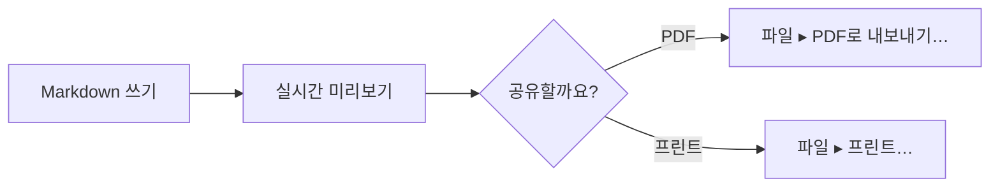

# Mac에서 Mermaid 미리보기.

Mermaid를 쓰면 Markdown 파일 안에 다이어그램을 텍스트로 쓸 수 있습니다. 대부분의 편집기는 그 텍스트만 보여 줍니다. MarsDawn은 다이어그램을 그려 줍니다. 소스 옆의 미리보기에서, Finder의 훑어보기에서, 내보낸 PDF에서요.

## 다이어그램을 텍스트로 쓰기

다이어그램을 `mermaid`로 표시한 코드 블록에 넣으세요:

````

````

MarsDawn에서는 이 블록이 순서도가 됩니다. Markdown 쓰기에서 실시간 미리보기로, 그다음 “공유할까요?”라는 선택에서 PDF 또는 프린트로 이어집니다.


## 다이어그램이 그려지는 곳

- **미리보기에서.** 파일을 열면 다이어그램이 소스 옆에 나타납니다(⌘2). 입력할 때마다 페이지가 업데이트되고, 두 패널이 함께 스크롤됩니다.
- **훑어보기에서.** Finder에서 파일을 선택하고 스페이스 바를 누르면 그곳에서도 다이어그램이 그려집니다.
- **PDF에서.** “파일 ▸ PDF로 내보내기…”와 “파일 ▸ 프린트…”는 다이어그램을 페이지에 그려 넣습니다. 쪽 나누기는 다이어그램이 반으로 잘리지 않도록 피합니다. PDF는 테마의 라이트 색상을 사용합니다.
- **명령줄에서.** 무료 `marsdawn export` 도구는 앱 없이도 같은 다이어그램을 PDF에 그립니다. [명령줄](/ko/cli/)을 참고하세요.
- **테마에 맞춰서.** 미리보기의 화면 모드 설정은 다이어그램에도 적용되므로, 다이어그램도 라이트 또는 다크를 따릅니다.

## 다이어그램에 오류가 있을 때

Mermaid가 다이어그램을 그리지 못하면, 미리보기에 그 다이어그램의 소스가 표시되고 그 아래에 전체 오류 메시지가 나옵니다. 오류가 특정 줄을 가리키면 메시지를 클릭했을 때 편집기가 그 줄로 이동합니다. `marsdawn export --json`은 그려지지 않은 다이어그램을 `diagramErrors`에 보고하므로, 스크립트나 에이전트가 다이어그램이 그려지지 않았음을 알 수 있습니다.

## 알아 둘 점

- 편집하는 것은 Mermaid 텍스트입니다. 시각적인 다이어그램 편집기는 없고, 미리보기에서 상자를 끌 수도 없습니다.
- 어떤 종류의 다이어그램이 그려지는지는 앱에 들어 있는 Mermaid 버전에 따라 다릅니다. MarsDawn 1.1.0에는 Mermaid 12.0.0이 들어 있습니다. kit의 내보내기 테스트는 순서도, 시퀀스, 클래스, 상태, 개체 관계, 간트, 파이 차트, 마인드맵, 사용자 여정, 타임라인, git 그래프 등의 문서를 렌더링합니다.
- MarsDawn에는 AI 모델이 없으므로 다이어그램을 대신 써 주지 않습니다. [순서도 템플릿](/ko/templates/flowchart/)에는 직접 쓰는 에이전트에게 건넬 수 있는 프롬프트가 있습니다.

## 다음

- 이미 잘 그려지는 다이어그램에서 시작하기: [순서도 템플릿](/ko/templates/flowchart/).
- 내보내기: [PDF 내보내기](/ko/pdf/). 스크립트에서 내보내려면 [명령줄](/ko/cli/).
- 파일을 어떻게 여는지 모르겠다면? [Mac에서 .md 파일 여는 방법](/ko/view-markdown-on-mac/).

## Mac에서 사용해 보세요

MarsDawn은 무료로 다운로드할 수 있습니다. 14일 동안 모든 기능을 체험한 뒤 USD 4.99에 한 번만 잠금 해제하세요. 구독도, 계정도 없습니다. macOS 26 이상이 필요합니다.

[지금 다운로드하고 체험하기](https://apps.apple.com/app/id6812925073)

## 더 보기

- [MarsDawn](https://marsdawn.southern-light.dev/ko/index.md): 에이전트의 작업을 이끄는 사람을 위한 Markdown. 실시간 미리보기, Mermaid 다이어그램, PDF 내보내기를 갖춘 Mac 네이티브 편집기입니다. Mac App Store에서 구입할 수 있습니다.
- [기능 한눈에 보기](https://marsdawn.southern-light.dev/ko/features/index.md): Mac 네이티브 Markdown 편집기: 실시간 미리보기, Mermaid와 수식, 테마, 그리고 회의와 여백 메모, 종이 기록에 쓸 수 있는 깔끔한 PDF와 프린트 페이지.
- [내 글은 내 Mac에](https://marsdawn.southern-light.dev/ko/yours/index.md): MarsDawn에는 계정도, 동기화도, 클라우드도 없습니다. Markdown 문서는 직접 고른 파일과 폴더에 담겨 Mac에 남습니다.
- [무료로 체험하고, 한 번만 구입](https://marsdawn.southern-light.dev/ko/pay-once/index.md): MarsDawn은 무료로 다운로드할 수 있습니다. 14일 동안 모든 기능을 체험한 뒤 USD 4.99에 한 번만 잠금 해제하세요. 구독도, 계정도 없습니다.
- [PDF 내보내기](https://marsdawn.southern-light.dev/ko/pdf/index.md): Mac에서 Markdown을 PDF로 내보내거나 프린트하세요. Mermaid 다이어그램과 하이라이트된 코드도 그대로입니다. 페이지 나눔은 짧은 코드 블록과 표를 가르지 않도록 합니다.
- [Mac 앱](https://marsdawn.southern-light.dev/ko/native/index.md): 진짜 Mac 앱인 Markdown 편집기. 네이티브 윈도우와 탭, 자동 저장, 버전 기록, Finder의 훑어보기, 그리고 Mac답게 동작하는 텍스트 편집기를 갖췄습니다.
- [MarsDawn이 하지 않는 일](https://marsdawn.southern-light.dev/ko/limits/index.md): 동기화도, iPhone이나 iPad 앱도, 플러그인도, 계정도 없습니다. 기본 테마는 네 가지이고, 갤러리에 더 있습니다. 구입 전에 알아 두세요.
- [지원](https://marsdawn.southern-light.dev/ko/support/index.md): macOS용 Markdown 편집기 MarsDawn에 관한 도움말입니다.
- [개인정보 처리방침](https://marsdawn.southern-light.dev/ko/privacy/index.md): MarsDawn은 개인정보를 수집하지 않습니다. 문서와 설정은 사용자의 Mac에 남습니다.
- [Mac에서 .md 파일 여는 방법](https://marsdawn.southern-light.dev/ko/view-markdown-on-mac/index.md): Mac에서 .md 파일을 여는 방법: 더블 클릭, 기본 앱 지정, Finder 훑어보기. AI 에이전트가 쓴 .md 파일은 MarsDawn에서 렌더링된 모습으로 읽으세요.
- [Markdown을 PDF로](https://marsdawn.southern-light.dev/ko/markdown-to-pdf/index.md): 무료 marsdawn 명령줄 도구로 Mac에서 Markdown을 PDF로 변환하세요. Homebrew로 설치하고 명령 하나만 실행하면 됩니다. 표, 수식, Mermaid, 코드까지 지원합니다.
- [MacMD Viewer와 MarsDawn 비교](https://marsdawn.southern-light.dev/ko/vs/macmd-viewer/index.md): MacMD Viewer는 읽기 전용 Markdown 뷰어로 USD 19.99입니다. MarsDawn은 편집과 미리보기를 나란히 보여 주며, 14일 무료 체험 후 USD 4.99를 한 번만 내면 됩니다. 항목별 비교, 출처 포함.
- [명령줄](https://marsdawn.southern-light.dev/ko/cli/index.md): Mac용 무료 marsdawn 명령줄 도구. 셸, 스크립트, LLM 에이전트에서 Markdown을 PDF로 내보내고 JSON으로 결과를 받으세요. Homebrew로 설치합니다.
- [에이전트를 위한 marsdawn](https://marsdawn.southern-light.dev/ko/cli/agents/index.md): marsdawn을 호출해 Markdown을 PDF로 바꾸는 AI 에이전트와 스크립트를 위한 레퍼런스입니다. 명령, JSON 출력, 스키마, 종료 코드, 요구 사항을 다룹니다.
- [에이전트 스킬](https://marsdawn.southern-light.dev/ko/cli/skill/index.md): 코딩 에이전트가 불러오는 파일 하나로, 에이전트가 쓴 Markdown을 MarsDawn에서 열어 검토하게 하고, marsdawn을 설치해 Markdown을 PDF로 내보내고 JSON 결과를 읽게 합니다.
- [MCP 서버](https://marsdawn.southern-light.dev/ko/cli/mcp/index.md): marsdawn에는 자체 AI 모델이 없으므로 어떤 에이전트가 Markdown을 썼는지는 상관없습니다. CLI, 스킬 파일, MCP 서버 marsdawn-mcp 중 어디서 호출하든 세 가지 모두 같은 내보내기를 실행합니다.
- [토큰을 아끼는 검토](https://marsdawn.southern-light.dev/ko/token-efficient-review/index.md): 렌더링된 페이지는 사람이 MarsDawn에서 검토하며, 에이전트의 컨텍스트로 다시 읽어 들이지 않습니다. 도구 호출은 렌더링된 내용이 아니라 간결한 JSON 결과를 돌려주므로 호출 자체도 부담이 적습니다.
- [다른 도구로 Markdown 보기와 MarsDawn 비교](https://marsdawn.southern-light.dev/ko/vs/markdown-preview-tools/index.md): VS Code의 기본 미리보기, 브라우저 확장 프로그램, Claude Desktop의 파일 미리보기에서 Markdown을 읽는 것과 MarsDawn을 비교합니다. 각각 무엇을 렌더링하는지, 파일 하나를 여는 데 무엇이 필요한지 살펴보세요.
- [미리보기 테마와 PDF 내보내기](https://marsdawn.southern-light.dev/ko/themes/index.md): 라이트와 다크 팔레트를 각각 갖춘 미리보기 테마 네 가지, 그리고 지금 쓰는 테마를 그대로 따르는 PDF 내보내기와 프린트. 브라우저에서 테마를 직접 만들고, 커뮤니티 갤러리도 둘러보세요.
- [테마 만들기](https://marsdawn.southern-light.dev/ko/themes/new/index.md): 색과 몇 가지 스타일 옵션을 고르면 샘플 문서에 바로 반영됩니다. 만든 테마는 GitHub 이슈로 제출할 수 있습니다. 설치도 git도 필요 없습니다.
- [에이전트와 함께 테마 만들기](https://marsdawn.southern-light.dev/ko/themes/agents/index.md): MarsDawn 테마를 만드는 AI 에이전트를 위한 참고 자료입니다. theme.json의 모든 필드와 타입, 범위, CLI 검사·렌더링 절차, 넘겨줄 링크, 제출 방법을 담았습니다.
- [테마 갤러리](https://marsdawn.southern-light.dev/ko/themes/gallery/index.md): 커뮤니티가 MarsDawn에 제출한 미리보기 테마를 둘러보고, 용도로 걸러 보고, 문제가 있으면 신고하세요. 브라우저에서 직접 만드세요. 설치도 git도 필요 없습니다.
- [내보낸 PDF 공유하기](https://marsdawn.southern-light.dev/ko/sharing-exported-pdfs/index.md): 에이전트가 쓴 Markdown을 PDF로 내보내, Markdown을 읽지 않고 아무것도 설치하지 않을 동료에게 전달하세요. 문법도, 앱도, 계정도 없이 열립니다.
- [AI가 만든 결과물에 여전히 사람의 읽기가 필요한 이유](https://marsdawn.southern-light.dev/ko/reviewing-ai-output/index.md): AI가 쓴 Markdown은 보자마자 믿을 것이 아니라 사람이 이해해야 합니다. MarsDawn은 렌더링된 페이지를 원본 옆에 두고 Mermaid 다이어그램과 KaTeX 수식을 그려 주어, 구조를 한눈에 읽을 수 있게 합니다.
- [에이전트가 돌려준 결과 읽기](https://marsdawn.southern-light.dev/ko/reading-agent-output/index.md): AI 에이전트는 계획, 사양서, 진행 보고서 같은 결과를 Markdown으로 돌려줍니다. 에이전트를 만드는 사람들이 체크포인트와 실패에 대해 하는 말, 그 결과물이 읽기 어려운 이유, 그리고 계획을 5분 만에 검토하는 체크리스트를 소개합니다.
- [에이전트의 투명성](https://marsdawn.southern-light.dev/ko/agent-transparency/index.md): Anthropic의 에이전트 구축 가이드는 투명성, 즉 계획 단계를 보여 줄 것을 요구합니다. 가이드가 말하는 것과 말하지 않는 것, 그리고 그 단계들이 왜 대개 누군가 읽어야 하는 Markdown 파일로 끝나는지 살펴봅니다.
- [에이전트의 계획 검토하기](https://marsdawn.southern-light.dev/ko/reviewing-agent-plans/index.md): AI 에이전트가 넘긴 계획을 실행 전에 약 5분 동안, 어떤 에디터에서든 검토하는 6단계 방법을 예시와 함께 소개합니다.
- [에이전트 설계 패턴](https://marsdawn.southern-light.dev/ko/agent-design-patterns/index.md): Andrew Ng이 설명한 리플렉션, 도구 사용, 계획, 멀티 에이전트 협업과, 각 패턴이 보통 읽을거리로 넘기는 것을 정리했습니다.
- [변경 내역](https://marsdawn.southern-light.dev/ko/changelog/index.md): 무료 marsdawn 명령줄 도구에서 바뀐 점입니다.
- [편집자의 독서 노트](https://marsdawn.southern-light.dev/ko/reading-notes/index.md): AI 에이전트를 만드는 사람들이 실제로 무엇을 주장하는지 살피는 짧은 노트 여섯 편 — Anthropic, Chip Huyen, Lilian Weng, Harrison Chase, LangChain, Andrew Ng — 그리고 각각이 그런 에이전트가 돌려준 것을 읽어야 하는 사람에게 무엇을 의미하는지.
- [독서 노트: Anthropic](https://marsdawn.southern-light.dev/ko/reading-notes/anthropic-building-effective-agents/index.md): 2024년 12월 Anthropic이 에이전트를 만드는 사람을 위해 낸 가이드는 workflow와 agent를 나누고, 그중 하나가 두 번째 LLM 호출로 첫 번째를 검토하는 다섯 가지 workflow 패턴을 설명합니다. 그게 폴더에 떨어지는 파일에 무엇을 뜻하는지.
- [독서 노트: Chip Huyen](https://marsdawn.southern-light.dev/ko/reading-notes/chip-huyen-agents/index.md): Chip Huyen의 2025년 1월 에세이 «Agents»는 에이전트 행동을 read-only와 write로 나눕니다. 그 구분이 계획에서 승인 전에 더 자세히 볼 줄을 빠르게 짚는 방법이 되는 이유.
- [독서 노트: Lilian Weng](https://marsdawn.southern-light.dev/ko/reading-notes/lilian-weng-llm-agents/index.md): Lilian Weng의 널리 인용되는 2023년 서베이는 LLM 에이전트를 뇌와 계획·기억·도구 사용으로 그립니다. 각 부분이 당신에게 남기기 쉬운 파일, 그리고 예상치 못한 일에 조정되지 않는 계획에서 그녀가 짚는 한계.
- [독서 노트: Harrison Chase](https://marsdawn.southern-light.dev/ko/reading-notes/harrison-chase-what-is-an-agent/index.md): Harrison Chase의 2024년 에이전트 정의와 agentic 행동의 스펙트럼, 그리고 시스템이 그 위를 따라갈수록 관측 가능성이 필요하다는 주장 — 에이전트가 돌려준 파일을 읽는 쪽에서의 읽기.
- [독서 노트: LangChain(Jess Ou)](https://marsdawn.southern-light.dev/ko/reading-notes/langchain-what-is-an-agent/index.md): LangChain의 2026년 «What is an AI agent?»(Jess Ou)는 Harrison Chase의 2024년 정의를 이어받고, 에이전트를 자동으로 평가하는 파이프라인을 그립니다. 그 파이프라인이 아직 사람에게 넘기는 단계, 그리고 넘기지 않는 단계.
- [독서 노트: Andrew Ng](https://marsdawn.southern-light.dev/ko/reading-notes/andrew-ng-design-patterns/index.md): The Batch의 편지 다섯 편에서 Andrew Ng은 성찰, 도구 사용, 계획, 다중 에이전트 협업을 각각 얼마나 믿을 만하고 예측 가능한지로 순위를 매깁니다 — 그리고 그 순위가 각 패턴의 출력을 얼마나 자세히 볼지에 대해 시사하는 바.
- [템플릿](https://marsdawn.southern-light.dev/ko/templates/index.md): 에이전트가 쓰고 여러분이 읽는 문서를 위한 Markdown 템플릿입니다. 명세서, 순서도, 회의록이 있으며, 각각 에이전트에게 줄 프롬프트가 함께 제공됩니다.
- [명세서 템플릿](https://marsdawn.southern-light.dev/ko/templates/spec/index.md): 요구 사항, Mermaid 흐름도, 인수 기준이 들어 있는 Markdown 명세서 템플릿입니다. 에이전트가 채우고, 여러분은 MarsDawn에서 검토하세요.
- [순서도 템플릿](https://marsdawn.southern-light.dev/ko/templates/flowchart/index.md): Markdown으로 쓰는 Mermaid 순서도 템플릿으로, 다이어그램 아래에 단계를 풀어 씁니다. Mac에서 미리 보고 PDF로 내보내세요.
- [회의록 템플릿](https://marsdawn.southern-light.dev/ko/templates/meeting-notes/index.md): 결정 사항과 담당자가 정해진 실행 항목을 정리하는 Markdown 회의록 템플릿입니다. 에이전트가 쓰고, 여러분은 MarsDawn에서 확인하세요.
- [English](https://marsdawn.southern-light.dev/mermaid-preview-mac/index.md): See Mermaid diagrams drawn next to your Markdown on a Mac: live preview, Quick Look and PDF export. A broken diagram shows its error and the line.
- [繁體中文](https://marsdawn.southern-light.dev/zh-hant/mermaid-preview-mac/index.md): 在 Mac 上預覽 Mermaid 圖表：原始碼旁邊即時畫出來，快速查看和輸出 PDF 也看得到。圖表寫錯時，會顯示錯誤訊息和出錯的那一行。
- [简体中文](https://marsdawn.southern-light.dev/zh-hans/mermaid-preview-mac/index.md): 在 Mac 上预览 Mermaid 图表：源代码旁边实时画出来，快速查看和导出 PDF 也看得到。图表写错时，会显示错误信息和出错的那一行。
- [日本語](https://marsdawn.southern-light.dev/ja/mermaid-preview-mac/index.md): Mac で Mermaid の図を Markdown の隣に描画：リアルタイムプレビュー、クイックルック、PDF 書き出し。図に誤りがあると、エラーとその行が表示されます。
- [Deutsch](https://marsdawn.southern-light.dev/de/mermaid-preview-mac/index.md): Mermaid-Diagramme auf dem Mac neben deinem Markdown: Live-Vorschau, Übersicht und PDF-Export. Ein fehlerhaftes Diagramm zeigt den Fehler und die Zeile.
- [Français](https://marsdawn.southern-light.dev/fr/mermaid-preview-mac/index.md): Diagrammes Mermaid dessinés à côté de votre Markdown sur Mac : aperçu en direct, Coup d’œil et export PDF. Un diagramme erroné affiche l’erreur et la ligne.
- [Español](https://marsdawn.southern-light.dev/es/mermaid-preview-mac/index.md): Diagramas Mermaid junto a tu Markdown en una Mac: vista previa en vivo, Vista rápida y exportación a PDF. Un diagrama con errores muestra el error y la línea.
