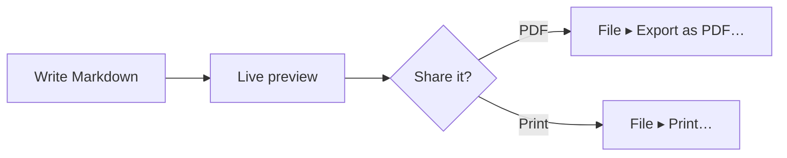

# Mermaid preview on Mac.

Mermaid lets you write a diagram as text inside a Markdown file. Most editors show you the text. MarsDawn draws the diagram: in the preview next to the source, in Quick Look in Finder, and in the PDF you export.

## Write the diagram as text

Put the diagram in a code block marked `mermaid`:

````

````

In MarsDawn that block becomes a flowchart: Write Markdown, then Live preview, then a Share it? choice that leads to PDF or Print.


## Where the diagram is drawn

- **In the preview.** Open the file and the diagram sits next to its source (⌘2). The page updates as you type, and the two panes scroll together.
- **In Quick Look.** Select the file in Finder and press Space; diagrams are drawn there too.
- **In the PDF.** File ▸ Export as PDF… and File ▸ Print… draw the diagram into the page. Page breaks avoid cutting a diagram in half. The PDF uses the theme's light colors.
- **From the command line.** The free `marsdawn export` tool draws the same diagrams into a PDF, and does not need the app. See [Command Line](/cli/).
- **In your theme.** The preview's Appearance setting applies to diagrams too, so a diagram follows light or dark.

## When the diagram has a mistake

If Mermaid can't draw a diagram, the preview shows the diagram's source with the full error message underneath. When the error names a line, click the message and the editor jumps to that line. `marsdawn export --json` reports failed diagrams in `diagramErrors`, so a script or an agent can tell that a diagram didn't draw.

## What to know

- You edit the Mermaid text. There is no visual diagram editor, and you can't drag boxes in the preview.
- Which diagram types draw depends on the Mermaid version inside the app. MarsDawn 1.1.0 includes Mermaid 12.0.0. The kit's export tests render documents for flowcharts, sequence, class, state, entity-relationship, Gantt, pie, mindmap, journey, timeline and git graphs, among others.
- MarsDawn has no AI model, so it doesn't write a diagram for you. The [flowchart template](/templates/flowchart/) has a prompt you can hand to your own agent.

## Next

- Start from a diagram that already works: the [flowchart template](/templates/flowchart/).
- Export it: [PDF export](/pdf/), or from a script, [Command Line](/cli/).
- Not sure how to open the file? [How to open .md files on Mac](/view-markdown-on-mac/).

## Try it on your Mac

MarsDawn is free to download. Try everything for 14 days, then unlock it once for USD 4.99. No subscription, no account. It needs macOS 26 or later.

[Download and try it free](https://apps.apple.com/app/id6812925073)

## More

- [MarsDawn](https://marsdawn.southern-light.dev/index.md): Read and review your agent's Markdown, JSON and YAML natively on Mac: live preview, Mermaid, KaTeX, Quick Look, PDF export. Free to try, USD 4.99 once.
- [Features](https://marsdawn.southern-light.dev/features/index.md): A native Mac editor for Markdown, JSON and YAML: live preview, Mermaid and math, themes, plus clean PDF and print pages for meetings and records.
- [Your writing stays on your Mac](https://marsdawn.southern-light.dev/yours/index.md): MarsDawn has no account, no sync and no cloud. Your Markdown documents stay on your Mac, in the files and folders you choose.
- [Try free, pay once](https://marsdawn.southern-light.dev/pay-once/index.md): MarsDawn is free to download. Try everything for 14 days, then unlock it once for USD 4.99. No subscription, no account.
- [PDF export](https://marsdawn.southern-light.dev/pdf/index.md): Export Markdown as a PDF or print it on your Mac, with Mermaid diagrams and highlighted code. Page breaks avoid splitting short code blocks.
- [A Mac app](https://marsdawn.southern-light.dev/native/index.md): A Markdown editor that is a real Mac app: native windows and tabs, autosave, version history, Quick Look in Finder and a text editor that behaves like a Mac.
- [What MarsDawn doesn't do](https://marsdawn.southern-light.dev/limits/index.md): No sync, no editing on iPhone or iPad, no plugins, no accounts. Themes, but no custom CSS. Know before you buy.
- [Support](https://marsdawn.southern-light.dev/support/index.md): Get help with MarsDawn, the Markdown editor for macOS.
- [Privacy Policy](https://marsdawn.southern-light.dev/privacy/index.md): MarsDawn does not collect personal data. Your documents and settings stay on your Mac.
- [How to open .md files on Mac](https://marsdawn.southern-light.dev/view-markdown-on-mac/index.md): How to open a .md file on a Mac: double-click, set a default app, preview in Finder. For .md files an AI agent wrote, read them rendered in MarsDawn.
- [Quick Look for Markdown](https://marsdawn.southern-light.dev/quicklook/index.md): MarsDawn's Quick Look renders Markdown in Finder when you press Space, with Mermaid, KaTeX and highlighted code. It keeps working after the trial ends.
- [Markdown to PDF](https://marsdawn.southern-light.dev/markdown-to-pdf/index.md): Convert Markdown to PDF on a Mac with the free marsdawn command-line tool. Install it with Homebrew and run one command: tables, math, Mermaid and code.
- [MarsDawn compared: VS Code preview, Obsidian, QLMarkdown, LynxOffice](https://marsdawn.southern-light.dev/vs/index.md): For anyone choosing how to read and review Markdown on a Mac, often what an agent wrote. Every cell below comes from the vendor's own pages or our own check, all on 16 October 2026; products change, so a cell can go stale. If you spot a mistake, write to the address on Support.
- [MacMD Viewer vs. MarsDawn](https://marsdawn.southern-light.dev/vs/macmd-viewer/index.md): MacMD Viewer is a read-only Markdown viewer for USD 19.99. MarsDawn edits and previews side by side: free for 14 days, then USD 4.99 once.
- [Best Markdown viewer for Mac (2026)](https://marsdawn.southern-light.dev/best-markdown-viewer-mac/index.md): Eight Markdown viewers for Mac compared by price, Mermaid, math, PDF, live reload, Quick Look and native vs Electron, with who each one suits.
- [Command Line](https://marsdawn.southern-light.dev/cli/index.md): The free marsdawn command-line tool for Mac: export Markdown to PDF from a shell, a script or an LLM agent, with JSON output. Install it with Homebrew.
- [marsdawn for agents](https://marsdawn.southern-light.dev/cli/agents/index.md): A reference for AI agents and scripts that call marsdawn to turn Markdown into PDF: commands, JSON output, schemas, exit codes and requirements.
- [Agent skill](https://marsdawn.southern-light.dev/cli/skill/index.md): One file your coding agent loads to open Markdown it wrote in MarsDawn for your review, and to install marsdawn, export Markdown to PDF and read the JSON result.
- [MCP server](https://marsdawn.southern-light.dev/cli/mcp/index.md): marsdawn has no AI model of its own, so it doesn't matter which agent wrote the Markdown. Call it from the CLI, a skill file, or the marsdawn-mcp MCP server: all three run the same export.
- [Token-efficient review](https://marsdawn.southern-light.dev/token-efficient-review/index.md): A person reviews the rendered page in MarsDawn, never read back into the agent's context. The tool call itself returns a compact JSON result, not the rendered content, so calling it is cheap too.
- [Viewing Markdown elsewhere vs. MarsDawn](https://marsdawn.southern-light.dev/vs/markdown-preview-tools/index.md): How MarsDawn compares to reading Markdown in VS Code's built-in preview, a browser extension, or Claude Desktop's file preview: what each renders, and what it takes to open one file.
- [Themes](https://marsdawn.southern-light.dev/themes/index.md): Four built-in preview themes, each light and dark, plus a curated gallery you open from Settings in MarsDawn for Mac. Quick Look uses your theme.
- [Build a theme](https://marsdawn.southern-light.dev/themes/new/index.md): Pick colours and a handful of style options, see them applied to a sample document live, and submit your theme as a GitHub issue. No install, no git.
- [Make a theme with your agent](https://marsdawn.southern-light.dev/themes/agents/index.md): MarsDawn theme reference for AI agents: each theme.json field with type and range, the CLI loop that checks and renders it, a hand-off link, and how to submit.
- [Theme gallery](https://marsdawn.southern-light.dev/themes/gallery/index.md): Browse preview themes for MarsDawn, each reviewed by the developer, filter them by scenario, and report a problem with one. Build your own in the browser.
- [Sharing exported PDFs](https://marsdawn.southern-light.dev/sharing-exported-pdfs/index.md): Export an agent's Markdown to PDF and hand it to a colleague who doesn't read Markdown and won't install anything. No syntax, no app and no account needed to open it.
- [Why AI output still needs a human reader](https://marsdawn.southern-light.dev/reviewing-ai-output/index.md): AI-written Markdown still has to be understood by a person, not trusted on sight. MarsDawn pairs the rendered page with the source, and draws Mermaid diagrams and KaTeX math, so structure is legible at a glance.
- [Reading what your agent hands back](https://marsdawn.southern-light.dev/reading-agent-output/index.md): AI agents hand back their work as Markdown: plans, specs, progress reports. What people who build agents say about checkpoints and failures, why that output is hard to read, and a five-minute checklist for reviewing a plan.
- [Agent transparency](https://marsdawn.southern-light.dev/agent-transparency/index.md): Anthropic's guide to building agents asks for transparency: show the planning steps. What it says, what it doesn't, and why the steps usually end up as a Markdown file someone has to read.
- [Reviewing an agent plan](https://marsdawn.southern-light.dev/reviewing-agent-plans/index.md): A six-step way to review the plan an AI agent hands you before it runs, in about five minutes and in any editor, with a worked example.
- [Agent design patterns](https://marsdawn.southern-light.dev/agent-design-patterns/index.md): Reflection, tool use, planning and multi-agent collaboration, as Andrew Ng described them, and what each tends to hand back for you to read.
- [Changelog](https://marsdawn.southern-light.dev/changelog/index.md): What changed in each version of the MarsDawn app and the free marsdawn CLI.
- [Roadmap](https://marsdawn.southern-light.dev/roadmap/index.md): What's in progress and what's next for MarsDawn on Mac, iPhone and iPad, by version. No dates, and unscheduled ideas are marked.
- [Editor's reading notes](https://marsdawn.southern-light.dev/reading-notes/index.md): Six short notes on what the people building AI agents actually argue — Anthropic, Chip Huyen, Lilian Weng, Harrison Chase, LangChain and Andrew Ng — and what each one means for the person who has to read what such an agent hands back.
- [Reading notes: Anthropic](https://marsdawn.southern-light.dev/reading-notes/anthropic-building-effective-agents/index.md): Anthropic's December 2024 guide for people building agents separates workflows from agents and describes five workflow patterns, including one where a second LLM call reviews the first. What that means for what lands in your folder.
- [Reading notes: Chip Huyen](https://marsdawn.southern-light.dev/reading-notes/chip-huyen-agents/index.md): Chip Huyen's January 2025 essay on agents splits their actions into read-only and write actions. Why that split is a fast way to spot the line in a plan worth a closer look before you approve it.
- [Reading notes: Lilian Weng](https://marsdawn.southern-light.dev/reading-notes/lilian-weng-llm-agents/index.md): Lilian Weng's widely cited 2023 survey describes an LLM agent as a brain plus planning, memory and tool use. What each part tends to leave behind for you to read, and the limitation she names in plans that don't adjust to surprises.
- [Reading notes: Harrison Chase](https://marsdawn.southern-light.dev/reading-notes/harrison-chase-what-is-an-agent/index.md): Harrison Chase's 2024 definition of an agent and his spectrum of agentic behavior, and his case for observability as a system moves along it — read from the side of whoever reads the file it hands back.
- [Reading notes: LangChain (Jess Ou)](https://marsdawn.southern-light.dev/reading-notes/langchain-what-is-an-agent/index.md): LangChain's 2026 “What is an AI agent?” by Jess Ou echoes Harrison Chase's 2024 definition and describes a pipeline for evaluating agents automatically. Where that pipeline still hands a step to a person, and where it doesn't.
- [Reading notes: Andrew Ng](https://marsdawn.southern-light.dev/reading-notes/andrew-ng-design-patterns/index.md): Across five letters in The Batch, Andrew Ng ranks reflection, tool use, planning and multi-agent collaboration by how reliable and predictable he finds each one — and what that ranking suggests about how closely to check each one's output.
- [Templates](https://marsdawn.southern-light.dev/templates/index.md): Markdown templates for the documents an agent writes and you read: a spec, a flowchart and meeting notes, each with a prompt for your agent.
- [Spec template](https://marsdawn.southern-light.dev/templates/spec/index.md): A Markdown spec template with requirements, a Mermaid flow diagram and acceptance criteria. Your agent fills it in; you review it in MarsDawn.
- [Flowchart template](https://marsdawn.southern-light.dev/templates/flowchart/index.md): A Mermaid flowchart template in Markdown, with the steps written out below it. Preview it on a Mac and export it to PDF.
- [Meeting notes template](https://marsdawn.southern-light.dev/templates/meeting-notes/index.md): A Markdown meeting notes template with decisions and action items, each with an owner. Your agent writes it up; you check it in MarsDawn.
- [繁體中文](https://marsdawn.southern-light.dev/zh-hant/mermaid-preview-mac/index.md): 在 Mac 上預覽 Mermaid 圖表：原始碼旁邊即時畫出來，快速查看和輸出 PDF 也看得到。圖表寫錯時，會顯示錯誤訊息和出錯的那一行。
- [简体中文](https://marsdawn.southern-light.dev/zh-hans/mermaid-preview-mac/index.md): 在 Mac 上预览 Mermaid 图表：源代码旁边实时画出来，快速查看和导出 PDF 也看得到。图表写错时，会显示错误信息和出错的那一行。
- [日本語](https://marsdawn.southern-light.dev/ja/mermaid-preview-mac/index.md): Mac で Mermaid の図を Markdown の隣に描画：リアルタイムプレビュー、クイックルック、PDF 書き出し。図に誤りがあると、エラーとその行が表示されます。
- [Deutsch](https://marsdawn.southern-light.dev/de/mermaid-preview-mac/index.md): Mermaid-Diagramme auf dem Mac neben deinem Markdown: Live-Vorschau, Übersicht und PDF-Export. Ein fehlerhaftes Diagramm zeigt den Fehler und die Zeile.
- [Français](https://marsdawn.southern-light.dev/fr/mermaid-preview-mac/index.md): Diagrammes Mermaid dessinés à côté de votre Markdown sur Mac : aperçu en direct, Coup d’œil et export PDF. Un diagramme erroné affiche l’erreur et la ligne.
- [Español](https://marsdawn.southern-light.dev/es/mermaid-preview-mac/index.md): Diagramas Mermaid junto a tu Markdown en una Mac: vista previa en vivo, Vista Rápida y exportación a PDF. Un diagrama con errores muestra el error y la línea.
- [한국어](https://marsdawn.southern-light.dev/ko/mermaid-preview-mac/index.md): Mac에서 Mermaid 다이어그램을 Markdown 옆에 그려서 보세요: 실시간 미리보기, 훑어보기, PDF 내보내기. 다이어그램에 오류가 있으면 오류와 해당 줄이 표시됩니다.
