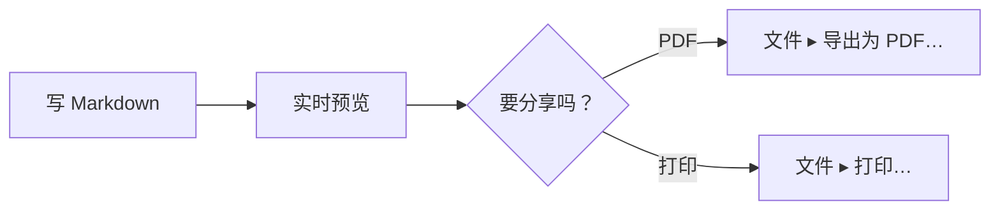

# 在 Mac 上预览 Mermaid。

Mermaid 让你用文本在 Markdown 文件里写一张图。多数编辑器只给你看那段文本。MarsDawn 会把图画出来：在源代码旁边的预览、在访达的快速查看，也在你导出的 PDF 里。

## 用文本写出图

把图放进标记为 `mermaid` 的代码块：

````

````

在 MarsDawn 里，这个代码块会画成一张流程图：写 Markdown，接着实时预览，再到“要分享吗？”这个选择，分成导出 PDF 和打印两条路。


## 图会画在哪里

- **预览里。** 打开文件，图就在源代码旁边（⌘2）。页面随着打字更新，两边的窗格一起滚动。
- **快速查看里。** 在访达中选中文件按空格键，图也会画出来。
- **PDF 里。** “文件 ▸ 导出为 PDF…”和“文件 ▸ 打印…”都会把图画进页面，分页时尽量不把一张图切成两半。PDF 使用主题的浅色配色。
- **命令行。** 免费的 `marsdawn export` 工具会把同样的图画进 PDF，而且不需要 app。请看[命令行工具](/zh-hans/cli/)。
- **跟着外观。** 预览的外观设置也会应用到图表，所以图会跟着浅色或深色。

## 图写错的时候

Mermaid 画不出一张图时，预览会显示那张图的源代码，下方附上完整的错误信息。如果错误信息指出是哪一行，点按一下信息，编辑器就会跳到那一行。`marsdawn export --json` 会在 `diagramErrors` 里报告画不出来的图，所以脚本或代理知道有图没画成。

## 先知道的事

- 你编辑的是 Mermaid 文本。没有可视化的图表编辑器，也不能在预览里拖动方块。
- 哪些图表类型画得出来，取决于 app 里内置的 Mermaid 版本。MarsDawn 1.1.0 内置 Mermaid 12.0.0。kit 的导出测试会对流程图、时序图、类图、状态图、实体关系图、甘特图、饼图、思维导图、用户旅程、时间线、git 图等类型各画一份文档。
- MarsDawn 没有 AI 模型，不会帮你写图。[流程图模板](/zh-hans/templates/flowchart/)附有一段提示词，可以交给你自己的代理。

## 接下来

- 从一张已经能画出来的图开始：[流程图模板](/zh-hans/templates/flowchart/)。
- 导出：[导出 PDF](/zh-hans/pdf/)；从脚本导出，请看[命令行工具](/zh-hans/cli/)。
- 不确定怎么打开文件？请看[Mac 上怎么打开 md 文件](/zh-hans/view-markdown-on-mac/)。

## 在你的 Mac 上试试

MarsDawn 可以免费下载。先免费试用 14 天，之后花 USD 4.99 解锁一次就好。没有订阅，也不需要账户。需要 macOS 26 以上。

[立即下载试用](https://apps.apple.com/app/id6812925073)

## 其他页面

- [MarsDawn](https://marsdawn.southern-light.dev/zh-hans/index.md): 检查代理写的 Markdown、JSON、YAML：Mac 原生 app，实时预览、Mermaid、KaTeX、快速查看、PDF。免费试用，之后一次 USD 4.99。
- [功能一览](https://marsdawn.southern-light.dev/zh-hans/features/index.md): Mac 原生的 Markdown、JSON、YAML 编辑器：实时预览、Mermaid 与数学公式、主题，导出和打印的页面可拿去开会或存档。
- [你写的内容留在你的 Mac 上](https://marsdawn.southern-light.dev/zh-hans/yours/index.md): MarsDawn 不需要账户，没有同步，也没有云端。你的 Markdown 文稿留在你的 Mac 上，就在你选的文件和文件夹里。
- [免费试用，买一次就好](https://marsdawn.southern-light.dev/zh-hans/pay-once/index.md): MarsDawn 免费下载。先免费试用 14 天，之后花 USD 4.99 解锁一次就好。没有订阅，也不需要账户。
- [导出 PDF](https://marsdawn.southern-light.dev/zh-hans/pdf/index.md): 在 Mac 上把 Markdown 导出成 PDF 或打印，Mermaid 图表和代码高亮都会保留；分页会尽量不切开短的代码，超过一页的会接到下一页。
- [为 Mac 而做](https://marsdawn.southern-light.dev/zh-hans/native/index.md): 真正的 Mac app：原生窗口与标签页、自动保存、版本记录、在访达用快速查看预览 Markdown，文本编辑器的操作和 Mac 上其他 app 一致。
- [MarsDawn 做不到的事](https://marsdawn.southern-light.dev/zh-hans/limits/index.md): 没有同步、iPhone 和 iPad 上不能编辑、没有插件、不需要账户；可以换主题，但不能自定义 CSS。购买前先知道。
- [支持](https://marsdawn.southern-light.dev/zh-hans/support/index.md): MarsDawn（macOS Markdown 编辑器）的使用说明与联系方式。
- [隐私政策](https://marsdawn.southern-light.dev/zh-hans/privacy/index.md): MarsDawn 不收集任何个人数据，你的文稿与设置都留在你的 Mac 上。
- [Mac 上怎么打开 md 文件](https://marsdawn.southern-light.dev/zh-hans/view-markdown-on-mac/index.md): Mac 上怎么打开 md 文件：双击、设为默认 App、在访达用快速查看。AI 代理写出来的 .md，也可以用 MarsDawn 打开，读排好版的页面。
- [Markdown 快速查看](https://marsdawn.southern-light.dev/zh-hans/quicklook/index.md): MarsDawn 的快速查看让你在访达按空格键就能看到排版后的 Markdown，Mermaid 图表、KaTeX 数学公式和代码高亮都在。试用期结束后，快速查看照常可用。
- [Markdown 转 PDF](https://marsdawn.southern-light.dev/zh-hans/markdown-to-pdf/index.md): 免费的 Markdown 转 PDF 工具：在 Mac 上用 marsdawn 命令行，一个命令就把 Markdown 转成 PDF，表格、数学公式、Mermaid 图表和代码高亮都在。
- [MarsDawn 对比：VS Code 预览、Obsidian、QLMarkdown、LynxOffice](https://marsdawn.southern-light.dev/zh-hans/vs/index.md): 写给正在挑选工具、要在 Mac 上读 Markdown（常常是代理写的）的人。下表每一格都出自厂商自己的页面或我们实际的检查，日期都是 2026 年 10 月 16 日；产品会变，格子也可能过时。发现错误，请写信到支持页上的地址。
- [MacMD Viewer 对比 MarsDawn](https://marsdawn.southern-light.dev/zh-hans/vs/macmd-viewer/index.md): MacMD Viewer 是只读的 Markdown 查看器，USD 19.99。MarsDawn 边编辑边预览，免费试用 14 天，之后 USD 4.99 解锁一次。逐项比较，附来源。
- [2026 Mac Markdown 查看器推荐](https://marsdawn.southern-light.dev/zh-hans/best-markdown-viewer-mac/index.md): 比较 8 款 Mac Markdown 查看器的价格、Mermaid、数学公式、PDF、自动重新载入、快速查看与原生／Electron，并说明各自适合谁。
- [命令行工具](https://marsdawn.southern-light.dev/zh-hans/cli/index.md): 免费的 marsdawn 命令行工具：在 Mac 上从终端、脚本或 LLM 代理把 Markdown 导出成 PDF，并提供 JSON 输出。用 Homebrew 安装。
- [给 AI 代理的 marsdawn 参考](https://marsdawn.southern-light.dev/zh-hans/cli/agents/index.md): 给调用 marsdawn 把 Markdown 转成 PDF 的 AI 代理与脚本的参考：命令、JSON 输出、Schema、退出代码与系统需求。
- [给代理的 skill](https://marsdawn.southern-light.dev/zh-hans/cli/skill/index.md): 一个文件，让写程序的代理把自己写的 Markdown 在 MarsDawn 里打开给你审阅，也学会安装 marsdawn、把 Markdown 导出成 PDF，并读懂 JSON 结果。
- [MCP 服务器](https://marsdawn.southern-light.dev/zh-hans/cli/mcp/index.md): marsdawn 没有自己的 AI 模型，是哪个代理写出 Markdown 都无所谓。可以从 CLI、skill 文件，或 marsdawn-mcp 这个 MCP 服务器调用，三者最后都运行同一个 export。
- [节省 token 的审阅方式](https://marsdawn.southern-light.dev/zh-hans/token-efficient-review/index.md): 人在 MarsDawn 里读排版后的页面，不会被读回代理的 context。工具调用本身返回的也只是精简的 JSON，不是排版内容，调用本身就很便宜。
- [在别处看 Markdown，对比 MarsDawn](https://marsdawn.southern-light.dev/zh-hans/vs/markdown-preview-tools/index.md): MarsDawn 对比在 VS Code 内置预览、浏览器扩展，或 Claude Desktop 文件预览里看 Markdown：各自能排版出什么，打开一个文件要花多少功夫。
- [主题](https://marsdawn.southern-light.dev/zh-hans/themes/index.md): 内置四种预览主题，各有浅色与深色；在 Mac 版 MarsDawn 的设置里打开主题图库，还能安装更多。快速查看也会用你选的主题。
- [打造一个主题](https://marsdawn.southern-light.dev/zh-hans/themes/new/index.md): 挑选颜色和几个样式选项，实时看它们套用在范例文档上，再把主题送出成一个 GitHub issue。不用安装，也不用 git。
- [和代理一起做主题](https://marsdawn.southern-light.dev/zh-hans/themes/agents/index.md): 给 AI 代理的 MarsDawn 主题制作参考：theme.json 每个字段的类型与范围、检查并渲染的 CLI 流程、交给人的链接，以及怎么投稿。
- [主题图库](https://marsdawn.southern-light.dev/zh-hans/themes/gallery/index.md): 浏览 MarsDawn 的预览主题，每一个都经过开发者审核；可以按场景筛选，也可以举报有问题的主题。在浏览器里打造自己的主题，不用安装，也不用 git。
- [分享导出的 PDF](https://marsdawn.southern-light.dev/zh-hans/sharing-exported-pdfs/index.md): 把代理写的 Markdown 导出成 PDF，交给不写 Markdown、也不会安装任何东西的同事。不用懂语法，不用装 app，也不需要账号就能打开。
- [为什么 AI 写的东西还是需要人读过](https://marsdawn.southern-light.dev/zh-hans/reviewing-ai-output/index.md): AI 写的 Markdown 还是得由人来理解，不能因为读起来通顺就直接相信。MarsDawn 把排版后的页面和源代码并排，也把 Mermaid 图表与 KaTeX 数学式画出来，让结构一眼就看得懂。
- [读懂代理交回来的 Markdown](https://marsdawn.southern-light.dev/zh-hans/reading-agent-output/index.md): AI 代理把工作成果交成 Markdown：计划、规格、进度报告。做代理的人怎么谈检查点和失败、这些产出为什么难读，以及五分钟审完一份计划的检查清单。
- [代理的透明](https://marsdawn.southern-light.dev/zh-hans/agent-transparency/index.md): Anthropic 谈打造代理的指南要求透明：把规划步骤摊开来。它说了什么、没说什么，以及为什么这些步骤最后多半变成一份要有人读的 Markdown。
- [审代理计划](https://marsdawn.southern-light.dev/zh-hans/reviewing-agent-plans/index.md): 代理交出计划、还没开始执行之前，用六个步骤、大约五分钟把它审完。什么编辑器都能用，附一份实际的例子。
- [代理设计模式](https://marsdawn.southern-light.dev/zh-hans/agent-design-patterns/index.md): Andrew Ng 提出的四种代理设计模式：reflection、tool use、planning、multi-agent collaboration，以及每一种通常会交回什么要你读的文件。
- [更新记录](https://marsdawn.southern-light.dev/zh-hans/changelog/index.md): MarsDawn App 与免费的 marsdawn 命令行工具，每个版本改了什么。
- [路线图](https://marsdawn.southern-light.dev/zh-hans/roadmap/index.md): MarsDawn 在 Mac、iPhone 与 iPad 上正在做和接下来要做的功能，按版本列出。不写日期，未排期的项目另行标明。
- [编者的阅读笔记](https://marsdawn.southern-light.dev/zh-hans/reading-notes/index.md): 六篇短笔记，谈打造 AI 代理的人实际主张了什么——Anthropic、Chip Huyen、Lilian Weng、Harrison Chase、LangChain 与 Andrew Ng——以及这些主张对“要读代理交回来的东西”的人分别意味着什么。
- [阅读笔记：Anthropic](https://marsdawn.southern-light.dev/zh-hans/reading-notes/anthropic-building-effective-agents/index.md): Anthropic 在 2024 年 12 月发表的指南把 workflow 和代理分开来看，并描述了五种 workflow 模式，其中一种让另一次 LLM 调用来审查。这对落进你文件夹的东西来说，意味着什么。
- [阅读笔记：Chip Huyen](https://marsdawn.southern-light.dev/zh-hans/reading-notes/chip-huyen-agents/index.md): Chip Huyen 在 2025 年 1 月的文章里，把代理的动作分成 read-only 和 write action 两种。这个分法为什么是核准计划前，快速抓出该多看一眼的那一行的好方法。
- [阅读笔记：Lilian Weng](https://marsdawn.southern-light.dev/zh-hans/reading-notes/lilian-weng-llm-agents/index.md): Lilian Weng 2023 年被广泛引用的整理，把 LLM 代理描述成大脑加上规划、记忆、工具使用。每个部件通常会留给你读什么，以及她点名的一个限制：计划遇到意外不太会调整。
- [阅读笔记：Harrison Chase](https://marsdawn.southern-light.dev/zh-hans/reading-notes/harrison-chase-what-is-an-agent/index.md): Harrison Chase 2024 年对代理的定义，以及他自己的 agentic 光谱；他主张系统愈往自主那端走，就愈需要可观测性——从读那份文件的人的角度重新看一遍。
- [阅读笔记：LangChain（Jess Ou）](https://marsdawn.southern-light.dev/zh-hans/reading-notes/langchain-what-is-an-agent/index.md): LangChain 2026 年由 Jess Ou 撰写的《What is an AI agent?》，定义几乎和 Harrison Chase 2024 年那篇一样，并描述了一套自动评测代理的流程。这套流程哪里还留给人，哪里不留。
- [阅读笔记：Andrew Ng](https://marsdawn.southern-light.dev/zh-hans/reading-notes/andrew-ng-design-patterns/index.md): 在 The Batch 的五篇文章里，Andrew Ng 依可靠与可预测的程度，帮 reflection、tool use、planning 和 multi-agent collaboration 排序——这个排序，对你该多仔细检查哪一种的产出，有什么提示。
- [模板](https://marsdawn.southern-light.dev/zh-hans/templates/index.md): 给代理写、你来读的文档用的 Markdown 模板：规格文档、流程图和会议记录，每份都附一段给代理的提示词。
- [规格文档模板](https://marsdawn.southern-light.dev/zh-hans/templates/spec/index.md): Markdown 规格文档模板，包含需求、Mermaid 流程图和验收标准。代理来填，你在 MarsDawn 里审阅。
- [流程图模板](https://marsdawn.southern-light.dev/zh-hans/templates/flowchart/index.md): Markdown 的 Mermaid 流程图模板，图的下方把步骤写出来。在 Mac 上预览，也能导出成 PDF。
- [会议记录模板](https://marsdawn.southern-light.dev/zh-hans/templates/meeting-notes/index.md): Markdown 会议记录模板，列出决议和行动项，每项都有负责人。代理来写，你在 MarsDawn 里确认。
- [English](https://marsdawn.southern-light.dev/mermaid-preview-mac/index.md): See Mermaid diagrams drawn next to your Markdown on a Mac: live preview, Quick Look and PDF export. A broken diagram shows its error and the line.
- [繁體中文](https://marsdawn.southern-light.dev/zh-hant/mermaid-preview-mac/index.md): 在 Mac 上預覽 Mermaid 圖表：原始碼旁邊即時畫出來，快速查看和輸出 PDF 也看得到。圖表寫錯時，會顯示錯誤訊息和出錯的那一行。
- [日本語](https://marsdawn.southern-light.dev/ja/mermaid-preview-mac/index.md): Mac で Mermaid の図を Markdown の隣に描画：リアルタイムプレビュー、クイックルック、PDF 書き出し。図に誤りがあると、エラーとその行が表示されます。
- [Deutsch](https://marsdawn.southern-light.dev/de/mermaid-preview-mac/index.md): Mermaid-Diagramme auf dem Mac neben deinem Markdown: Live-Vorschau, Übersicht und PDF-Export. Ein fehlerhaftes Diagramm zeigt den Fehler und die Zeile.
- [Français](https://marsdawn.southern-light.dev/fr/mermaid-preview-mac/index.md): Diagrammes Mermaid dessinés à côté de votre Markdown sur Mac : aperçu en direct, Coup d’œil et export PDF. Un diagramme erroné affiche l’erreur et la ligne.
- [Español](https://marsdawn.southern-light.dev/es/mermaid-preview-mac/index.md): Diagramas Mermaid junto a tu Markdown en una Mac: vista previa en vivo, Vista Rápida y exportación a PDF. Un diagrama con errores muestra el error y la línea.
- [한국어](https://marsdawn.southern-light.dev/ko/mermaid-preview-mac/index.md): Mac에서 Mermaid 다이어그램을 Markdown 옆에 그려서 보세요: 실시간 미리보기, 훑어보기, PDF 내보내기. 다이어그램에 오류가 있으면 오류와 해당 줄이 표시됩니다.
