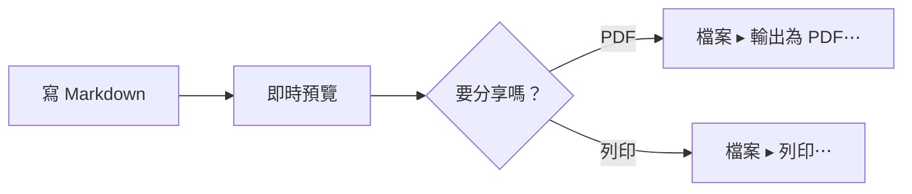

# 在 Mac 上預覽 Mermaid。

Mermaid 讓你用文字在 Markdown 檔案裡寫一張圖。多數編輯器只給你看那段文字。MarsDawn 會把圖畫出來：在原始碼旁邊的預覽、在 Finder 的快速查看，也在你輸出的 PDF 裡。

## 用文字寫出圖

把圖放進標記為 `mermaid` 的程式碼區塊：

````

````

在 MarsDawn 裡，這個區塊會畫成一張流程圖：寫 Markdown，接著即時預覽，再到「要分享嗎？」這個選擇，分成輸出 PDF 和列印兩條路。


## 圖會畫在哪裡

- **預覽裡。** 打開檔案，圖就在原始碼旁邊（⌘2）。頁面隨著打字更新，兩邊的窗格一起捲動。
- **快速查看裡。** 在 Finder 選取檔案按空白鍵，圖也會畫出來。
- **PDF 裡。** 「檔案 ▸ 輸出為 PDF⋯」和「檔案 ▸ 列印⋯」都會把圖畫進頁面，分頁時盡量不把一張圖切成兩半。PDF 使用主題的淺色配色。
- **命令列。** 免費的 `marsdawn export` 工具會把同樣的圖畫進 PDF，而且不需要 app。請看[命令列工具](/zh-hant/cli/)。
- **跟著外觀。** 預覽的外觀設定也會套用到圖表，所以圖會跟著淺色或深色。

## 圖寫錯的時候

Mermaid 畫不出一張圖時，預覽會顯示那張圖的原始碼，下方附上完整的錯誤訊息。如果錯誤訊息指出是哪一行，點一下訊息，編輯器就會跳到那一行。`marsdawn export --json` 會在 `diagramErrors` 裡回報畫不出來的圖，所以腳本或 agent 知道有圖沒畫成。

## 先知道的事

- 你編輯的是 Mermaid 文字。沒有視覺化的圖表編輯器，也不能在預覽裡拖動方塊。
- 哪些圖表類型畫得出來，取決於 app 裡內建的 Mermaid 版本。MarsDawn 1.1.0 內建 Mermaid 12.0.0。kit 的輸出測試會對流程圖、循序圖、類別圖、狀態圖、實體關聯圖、甘特圖、圓餅圖、心智圖、使用者旅程、時間軸、git 圖等類型各畫一份文件。
- MarsDawn 沒有 AI 模型，不會幫你寫圖。[流程圖範本](/zh-hant/templates/flowchart/)附有一段提示詞，可以交給你自己的 agent。

## 接下來

- 從一張已經能畫出來的圖開始：[流程圖範本](/zh-hant/templates/flowchart/)。
- 輸出：[輸出 PDF](/zh-hant/pdf/)；從腳本輸出，請看[命令列工具](/zh-hant/cli/)。
- 不確定怎麼打開檔案？請看[Mac 怎麼開 md 檔](/zh-hant/view-markdown-on-mac/)。

## 在你的 Mac 上試試

MarsDawn 可以免費下載。先免費試用 14 天，之後花 USD 4.99 解鎖一次就好。沒有訂閱，也不需要帳號。需要 macOS 26 以上。

[立刻下載試用](https://apps.apple.com/app/id6812925073)

## 其他頁面

- [MarsDawn](https://marsdawn.southern-light.dev/zh-hant/index.md): 讀懂、檢查 agent 寫的 Markdown 的 Mac 原生 app：分割即時預覽、Mermaid、KaTeX、快速查看、PDF 輸出。可免費試用，之後一次 USD 4.99。
- [功能一覽](https://marsdawn.southern-light.dev/zh-hant/features/index.md): Mac 原生的 Markdown 編輯器：即時預覽、Mermaid 與數學式、主題，輸出和列印的頁面可以拿去開會、用筆加註，或當紙本保存。
- [你寫的內容留在你的 Mac 上](https://marsdawn.southern-light.dev/zh-hant/yours/index.md): MarsDawn 不需要帳號，沒有同步，也沒有雲端。你的 Markdown 文件留在你的 Mac 上，就在你選的檔案和資料夾裡。
- [免費試用，買一次就好](https://marsdawn.southern-light.dev/zh-hant/pay-once/index.md): MarsDawn 免費下載。先免費試用 14 天，之後花 USD 4.99 解鎖一次就好。沒有訂閱，也不需要帳號。
- [輸出 PDF](https://marsdawn.southern-light.dev/zh-hant/pdf/index.md): 在 Mac 上把 Markdown 輸出成 PDF 或列印，Mermaid 圖表和程式碼上色都會保留；分頁會盡量不切開短的程式碼，超過一頁的會接到下一頁。
- [為 Mac 而做](https://marsdawn.southern-light.dev/zh-hant/native/index.md): 真正的 Mac app：原生視窗與分頁、自動儲存、版本記錄、在 Finder 用快速查看預覽 Markdown，文字編輯器的操作和 Mac 上其他 app 一致。
- [MarsDawn 做不到的事](https://marsdawn.southern-light.dev/zh-hant/limits/index.md): 沒有同步、沒有 iPhone 或 iPad 版、沒有外掛、不需要帳號；可以換主題，但不能自訂 CSS。購買前先知道。
- [支援](https://marsdawn.southern-light.dev/zh-hant/support/index.md): MarsDawn（macOS Markdown 編輯器）的使用說明與聯絡方式。
- [隱私權政策](https://marsdawn.southern-light.dev/zh-hant/privacy/index.md): MarsDawn 不收集任何個人資料，你的文件與設定都留在你的 Mac 上。
- [Mac 怎麼開 md 檔](https://marsdawn.southern-light.dev/zh-hant/view-markdown-on-mac/index.md): Mac 怎麼開 md 檔：雙擊、設成預設 App、在 Finder 用快速查看。AI agent 寫出來的 .md，也可以用 MarsDawn 打開，讀排好版的頁面。
- [Markdown 快速查看](https://marsdawn.southern-light.dev/zh-hant/quicklook/index.md): MarsDawn 的快速查看讓你在 Finder 按空白鍵就看到排版後的 Markdown，Mermaid 圖表、KaTeX 數學式和程式碼上色都在。試用期結束後，快速查看照常可用。
- [Markdown 轉 PDF](https://marsdawn.southern-light.dev/zh-hant/markdown-to-pdf/index.md): 免費的 Markdown 轉 PDF 工具：在 Mac 上用 marsdawn 命令列，一個指令就把 Markdown 轉成 PDF，表格、數學式、Mermaid 圖表和程式碼上色都在。
- [MarsDawn 比較：VS Code 預覽、Obsidian、QLMarkdown、LynxOffice](https://marsdawn.southern-light.dev/zh-hant/vs/index.md): 寫給正在挑選工具、要在 Mac 上讀 Markdown（常常是 agent 寫的）的人。下表每一格都出自廠商自己的頁面或我們實際的檢查，日期都是 2026 年 10 月 16 日；產品會變，格子也可能過時。發現錯誤，請寫信到支援頁上的地址。
- [MacMD Viewer 對比 MarsDawn](https://marsdawn.southern-light.dev/zh-hant/vs/macmd-viewer/index.md): MacMD Viewer 是唯讀的 Markdown 檢視器，USD 19.99。MarsDawn 邊編輯邊預覽，免費試用 14 天，之後 USD 4.99 解鎖一次。逐項比較，附來源。
- [2026 Mac Markdown 檢視器推薦](https://marsdawn.southern-light.dev/zh-hant/best-markdown-viewer-mac/index.md): 比較 8 款 Mac Markdown 檢視器的價格、Mermaid、數學式、PDF、自動重新載入、快速查看與原生／Electron，並說明各自適合誰。
- [命令列工具](https://marsdawn.southern-light.dev/zh-hant/cli/index.md): 免費的 marsdawn 命令列工具：在 Mac 上從終端機、腳本或 LLM agent 把 Markdown 匯出成 PDF，並提供 JSON 輸出。用 Homebrew 安裝。
- [給 AI agent 的 marsdawn 參考](https://marsdawn.southern-light.dev/zh-hant/cli/agents/index.md): 給呼叫 marsdawn 把 Markdown 轉成 PDF 的 AI agent 與腳本的參考：指令、JSON 輸出、Schema、離開代碼與系統需求。
- [給 agent 的 skill](https://marsdawn.southern-light.dev/zh-hant/cli/skill/index.md): 一個檔案，讓寫程式的 agent 把自己寫的 Markdown 在 MarsDawn 裡打開給你審閱，也學會安裝 marsdawn、把 Markdown 匯出成 PDF，並讀懂 JSON 結果。
- [MCP 伺服器](https://marsdawn.southern-light.dev/zh-hant/cli/mcp/index.md): marsdawn 沒有自己的 AI 模型，是哪個 agent 寫出 Markdown 都無所謂。可以從 CLI、skill 檔案，或 marsdawn-mcp 這個 MCP 伺服器呼叫，三者最後都執行同一個 export。
- [節省 token 的審閱方式](https://marsdawn.southern-light.dev/zh-hant/token-efficient-review/index.md): 人在 MarsDawn 裡讀排版後的頁面，不會被讀回 agent 的 context。工具呼叫本身回傳的也只是精簡的 JSON，不是排版內容，呼叫本身就很便宜。
- [在別處看 Markdown，對比 MarsDawn](https://marsdawn.southern-light.dev/zh-hant/vs/markdown-preview-tools/index.md): MarsDawn 對比在 VS Code 內建預覽、瀏覽器擴充功能，或 Claude Desktop 檔案預覽裡看 Markdown：各自能排版出什麼，打開一個檔案要花多少功夫。
- [主題](https://marsdawn.southern-light.dev/zh-hant/themes/index.md): 內建四種預覽主題，各有淺色與深色；在 Mac 版 MarsDawn 的設定裡打開主題庫，還能安裝更多。快速查看也會用你選的主題。
- [打造一個主題](https://marsdawn.southern-light.dev/zh-hant/themes/new/index.md): 挑選顏色和幾個樣式選項，即時看它們套用在範例文件上，再把主題送出成一個 GitHub issue。不用安裝，也不用 git。
- [和 agent 一起做主題](https://marsdawn.southern-light.dev/zh-hant/themes/agents/index.md): 給 AI agent 的 MarsDawn 主題製作參考：theme.json 每個欄位的型別與範圍、檢查並渲染的 CLI 流程、交給人的連結，以及怎麼投稿。
- [主題庫](https://marsdawn.southern-light.dev/zh-hant/themes/gallery/index.md): 瀏覽 MarsDawn 的預覽主題，每一個都經過開發者審核；可以依情境篩選，也可以檢舉有問題的主題。在瀏覽器裡打造自己的主題，不用安裝，也不用 git。
- [分享輸出的 PDF](https://marsdawn.southern-light.dev/zh-hant/sharing-exported-pdfs/index.md): 把 agent 寫的 Markdown 輸出成 PDF，交給不寫 Markdown、也不會安裝任何東西的同事。不用懂語法，不用裝 app，也不需要帳號就能打開。
- [為什麼 AI 寫的東西還是需要人讀過](https://marsdawn.southern-light.dev/zh-hant/reviewing-ai-output/index.md): AI 寫的 Markdown 還是得由人來理解，不能因為讀起來通順就直接相信。MarsDawn 把排版後的頁面和原始碼並排，也把 Mermaid 圖表與 KaTeX 數學式畫出來，讓結構一眼就看得懂。
- [讀懂 agent 交回來的 Markdown](https://marsdawn.southern-light.dev/zh-hant/reading-agent-output/index.md): AI agent 把工作成果交成 Markdown：計畫、規格、進度報告。做 agent 的人怎麼談檢查點和失敗、這些產出為什麼難讀，以及五分鐘審完一份計畫的檢查清單。
- [agent 的透明](https://marsdawn.southern-light.dev/zh-hant/agent-transparency/index.md): Anthropic 談打造 agent 的指南要求透明：把規劃步驟攤開來。它說了什麼、沒說什麼，以及為什麼這些步驟最後多半變成一份要有人讀的 Markdown。
- [審 agent 計畫](https://marsdawn.southern-light.dev/zh-hant/reviewing-agent-plans/index.md): agent 交出計畫、還沒開始執行之前，用六個步驟、大約五分鐘把它審完。什麼編輯器都能用，附一份實際的例子。
- [agent 設計模式](https://marsdawn.southern-light.dev/zh-hant/agent-design-patterns/index.md): Andrew Ng 提出的四種 agent 設計模式：reflection、tool use、planning、multi-agent collaboration，以及每一種通常會交回什麼要你讀的文件。
- [更新紀錄](https://marsdawn.southern-light.dev/zh-hant/changelog/index.md): MarsDawn App 與免費的 marsdawn 命令列工具，每個版本改了什麼。
- [路線圖](https://marsdawn.southern-light.dev/zh-hant/roadmap/index.md): MarsDawn 在 Mac、iPhone 與 iPad 上正在做與接下來要做的功能，依版本列出。不寫日期，未排程的項目另外標明。
- [編者的閱讀筆記](https://marsdawn.southern-light.dev/zh-hant/reading-notes/index.md): 六篇短筆記，談打造 AI agent 的人實際主張了什麼——Anthropic、Chip Huyen、Lilian Weng、Harrison Chase、LangChain 與 Andrew Ng——以及這些主張對「要讀 agent 交回來的東西」的人分別意味著什麼。
- [閱讀筆記：Anthropic](https://marsdawn.southern-light.dev/zh-hant/reading-notes/anthropic-building-effective-agents/index.md): Anthropic 在 2024 年 12 月發表的指南把 workflow 和 agent 分開來看，並描述了五種 workflow 模式，其中一種讓另一次 LLM 呼叫來審查。這對落進你資料夾的東西來說，意味著什麼。
- [閱讀筆記：Chip Huyen](https://marsdawn.southern-light.dev/zh-hant/reading-notes/chip-huyen-agents/index.md): Chip Huyen 在 2025 年 1 月的文章裡，把 agent 的動作分成 read-only 和 write action 兩種。這個分法為什麼是核準計畫前，快速拓出該多看一眼的那一行的好方法。
- [閱讀筆記：Lilian Weng](https://marsdawn.southern-light.dev/zh-hant/reading-notes/lilian-weng-llm-agents/index.md): Lilian Weng 2023 年被廣泛引用的整理，把 LLM agent 描述成大腦加上規劃、記憶、工具使用。每個部件通常會留給你讀什麼，以及她點名的一個限制：計畫遇到意外不太會調整。
- [閱讀筆記：Harrison Chase](https://marsdawn.southern-light.dev/zh-hant/reading-notes/harrison-chase-what-is-an-agent/index.md): Harrison Chase 2024 年對 agent 的定義，以及他自己的 agentic 光譜；他主張系統愉往自主那端走，就愉需要可觀測性——從讀那份檔案的人的角度重新看一遍。
- [閱讀筆記：LangChain（Jess Ou）](https://marsdawn.southern-light.dev/zh-hant/reading-notes/langchain-what-is-an-agent/index.md): LangChain 2026 年由 Jess Ou 撰寫的〈What is an AI agent?〉，定義幾乎和 Harrison Chase 2024 年那篇一樣，並描述了一套自動評測 agent 的流程。這套流程哪裡還留給人，哪裡不留。
- [閱讀筆記：Andrew Ng](https://marsdawn.southern-light.dev/zh-hant/reading-notes/andrew-ng-design-patterns/index.md): 在 The Batch 的五篇文章裡，Andrew Ng 依可靠與可預測的程度，幫 reflection、tool use、planning 和 multi-agent collaboration 排序——這個排序，對你該多仔細檢查哪一種的產出，有什麼提示。
- [範本](https://marsdawn.southern-light.dev/zh-hant/templates/index.md): 給 agent 寫、你來讀的文件用的 Markdown 範本：規格文件、流程圖和會議記錄，每份都附一段給 agent 的提示詞。
- [規格文件範本](https://marsdawn.southern-light.dev/zh-hant/templates/spec/index.md): Markdown 規格文件範本，含需求、Mermaid 流程圖和驗收條件。agent 來填，你在 MarsDawn 裡審閱。
- [流程圖範本](https://marsdawn.southern-light.dev/zh-hant/templates/flowchart/index.md): Markdown 的 Mermaid 流程圖範本，圖的下方把步驟寫出來。在 Mac 上預覽，也能輸出成 PDF。
- [會議記錄範本](https://marsdawn.southern-light.dev/zh-hant/templates/meeting-notes/index.md): Markdown 會議記錄範本，列出決議和行動項目，每項都有負責人。agent 來寫，你在 MarsDawn 裡確認。
- [English](https://marsdawn.southern-light.dev/mermaid-preview-mac/index.md): See Mermaid diagrams drawn next to your Markdown on a Mac: live preview, Quick Look and PDF export. A broken diagram shows its error and the line.
- [简体中文](https://marsdawn.southern-light.dev/zh-hans/mermaid-preview-mac/index.md): 在 Mac 上预览 Mermaid 图表：源代码旁边实时画出来，快速查看和导出 PDF 也看得到。图表写错时，会显示错误信息和出错的那一行。
- [日本語](https://marsdawn.southern-light.dev/ja/mermaid-preview-mac/index.md): Mac で Mermaid の図を Markdown の隣に描画：リアルタイムプレビュー、クイックルック、PDF 書き出し。図に誤りがあると、エラーとその行が表示されます。
- [Deutsch](https://marsdawn.southern-light.dev/de/mermaid-preview-mac/index.md): Mermaid-Diagramme auf dem Mac neben deinem Markdown: Live-Vorschau, Übersicht und PDF-Export. Ein fehlerhaftes Diagramm zeigt den Fehler und die Zeile.
- [Français](https://marsdawn.southern-light.dev/fr/mermaid-preview-mac/index.md): Diagrammes Mermaid dessinés à côté de votre Markdown sur Mac : aperçu en direct, Coup d’œil et export PDF. Un diagramme erroné affiche l’erreur et la ligne.
- [Español](https://marsdawn.southern-light.dev/es/mermaid-preview-mac/index.md): Diagramas Mermaid junto a tu Markdown en una Mac: vista previa en vivo, Vista rápida y exportación a PDF. Un diagrama con errores muestra el error y la línea.
- [한국어](https://marsdawn.southern-light.dev/ko/mermaid-preview-mac/index.md): Mac에서 Mermaid 다이어그램을 Markdown 옆에 그려서 보세요: 실시간 미리보기, 훑어보기, PDF 내보내기. 다이어그램에 오류가 있으면 오류와 해당 줄이 표시됩니다.
